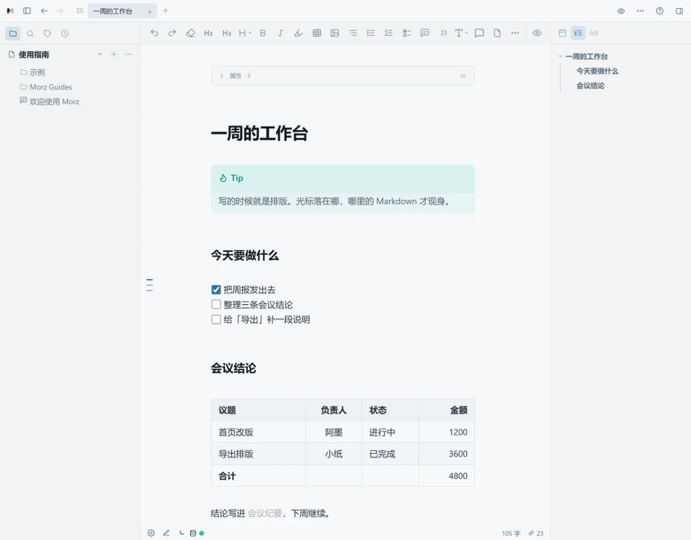

# Morz · 墨与纸

**English** · [简体中文](README.zh-CN.md)

> **Ink and paper — the only two things a writing tool needs.**
> The writing feel of Typora: what you type is already the final layout, and the Markdown source
> is right under the cursor — no switching between source and preview.
> The knowledge layer of Obsidian: `[[wikilinks]]`, backlinks, tags, properties, outline and graphs.
> And your notes stay ordinary `.md` files that Obsidian, Typora or VS Code can open directly.

Writing tools keep getting heavier: some feel great but lock your notes into private formats or
cloud accounts; others connect knowledge but edit like source code. Morz puts both back on the
same sheet of paper — fluid writing and a real knowledge layer, without taking your files hostage.

## Why Morz exists

[After 2.1 million plugin downloads, I decided to build an editor with "nothing" in it](docs/manual/story.md)
— the story of one 1 a.m. deadline, three plugins, three restarts, and the editor that should
have made all of it unnecessary.

## Plain Markdown, never locked in

Notes are ordinary `.md` files, in a folder of your choice:

- No account, no sign-in, works offline — nothing is relayed through a server
- No format lock-in: standard Markdown syntax; file history, trash and backups all stay local
- The desktop app is Rust + Tauri 2 (**not Electron**): a ~9 MB installer and a measured **2.93 s**
  cold start on a 10,000-note workspace

## Three things, done properly

| ✍️ Writing feel | 🕸 Knowledge network | 📱 Write anywhere |
| --- | --- | --- |
| What you type is already the layout; syntax appears only where the cursor lands. Tables, math, Mermaid diagrams and code blocks all edit in place — touch screens too. | `[[Wikilinks]]` with block references, backlinks, tags, local/global graphs, Dataview queries and property cards — a full knowledge layer over clean files. | Opens straight in the browser and installs as an offline PWA; a formatting bar sits above the iPad keyboard and Scribble keeps working; native builds for Windows, macOS, Linux and Android. |

## See it render

Callouts, task lists, properties and tables that calculate render in place — Markdown appears only where the cursor lands.

Inline and display math, Mermaid diagrams and code blocks are edited in place and render offline.

The same file on a phone: same layout, with the formatting bar within thumb reach.

## Two editions

**Morz · free edition**

The stable core: editing and reading, wikilinks and backlinks, graph, search, themes and the plugin community. Enough for everyday writing, free for good.

**Morz Insider · supporter seat**

Support the project and take an insider seat: features still in progress appear here first — the AI assistant, card columns, calendar and daily notes, quick capture. Earlier builds, and your reports get looked at first.

Insider builds promise no schedule, and not every experiment survives. Whatever stabilises moves into the free edition — supporters get early access, not exclusivity.

## Features

| | |
|---|---|
| Writing | WYSIWYG editing; tables (in-place cells, `=SUM` formulas, sorting, fill-handle series), code blocks (100+ languages), math via MathJax 4 offline, Mermaid diagrams, footnotes, GitHub-style alerts; card columns (headings become columns, write inside a card, full-screen card editing) |
| Organising | Wikilinks (incl. block references) and backlinks, tags, property cards, outline, local/global graphs, daily notes & templates, calendar, favorites & recents, pinyin-aware command palette |
| Export | PDF (page numbers, TOC page references, sidebar bookmarks), Word, HTML, long image (one PNG or a paginated zip); DOCX import with round-trip fidelity (experimental); copy tables or a text selection as images |
| Extending | Plugin & theme markets (Dataview, Tasks, AI assistant, Blue Topaz, Style Settings); installs verified per file with sha256 |
| Platforms | Windows / macOS / Linux / Android; runs in any modern browser and as a PWA; iPadOS touch layout |
| Data | Plain `.md`, links auto-updated on rename/move, image upload (S3-compatible endpoints), file history, trash, one-click backup |

## Install

Morz is in **closed beta** — installers are not published here yet. Ask for a link at
<https://morz.app/> (the web app is open to everyone).

- **Desktop**: free downloads for Windows, macOS (Apple Silicon / Intel) and Linux at <https://morz.app/#download>. Android is in closed beta.
- **Web / iPad**: the PWA is served from <https://app.morz.app>; install it from the browser menu
  (iPad: Share → Add to Home Screen) to keep an offline copy.
- Installed builds update from **Help → Check for Updates** (China-friendly mirror first, GitHub
  fallback).

## Downloads and auto-updates

- Free desktop installers live under <https://dl.morz.app/> (`v0.1.x/`); each platform also ships a minisign signature for the updater.
- Installer signatures are verified with minisign — a mirror cannot inject code.
- The portable `.exe` cannot auto-update; use the installer for in-app updates.

## Documentation

- **[Help center](docs/manual/README.md)** — setup, writing, organising, export, settings, FAQ, one page per task.
- **[Getting started](docs/manual/index.md)** — from the first launch to a finished document, with real screenshots.
- **[Feature guide](docs/manual/features.md)** — every menu item, what problem it solves, and when to use it.
- **[Compared with Obsidian, Typora and Mubu](docs/manual/compare.md)** — honest capability comparison, trade-offs, and when not to choose Morz.
- **[Plugin development](docs/PLUGIN-DEVELOPMENT.md)** · **[Plugin SDK](docs/PLUGIN-SDK.md)** · **[Theme development](docs/THEME-DEVELOPMENT.md)** · **[Blue Topaz](docs/BLUE-TOPAZ.md)** · **[Publishing guide](docs/PUBLISHING.md)**

## Plugins and themes

- Browse **Settings → Third-party plugins** for the plugin store, and
  **Settings → Appearance → Theme market** for themes.
- The index and checksums live in this repository under `registry/`; the client verifies every
  file's sha256 on install.

## About this repository

Morz is an independent project by Cuman, not affiliated with Typora or Obsidian.

## License

- **This repository** — docs, registry and example plugins — is **MIT licensed** ([LICENSE](LICENSE)).
  Code examples in the docs are MIT too; copy them freely.
- **The Morz application** is free to install and use, including for commercial work. It is not
  open source; please don't redistribute it or publish it under another name.
- **The name and logo** are not covered by MIT — they identify the official project.
- **Provided as is**, without warranty. Keep backups of your notes.
- **Third-party components** keep their own licenses ([THIRD-PARTY-NOTICES.md](THIRD-PARTY-NOTICES.md)).
