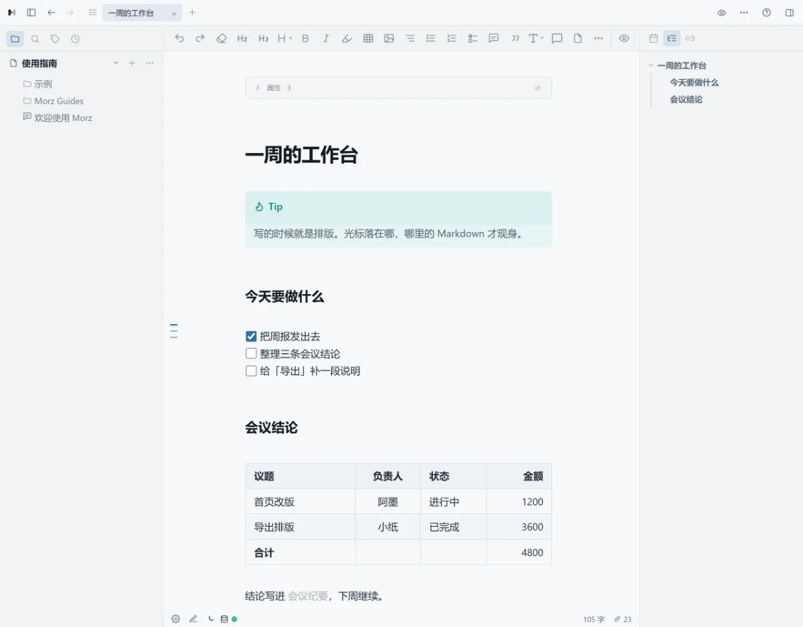
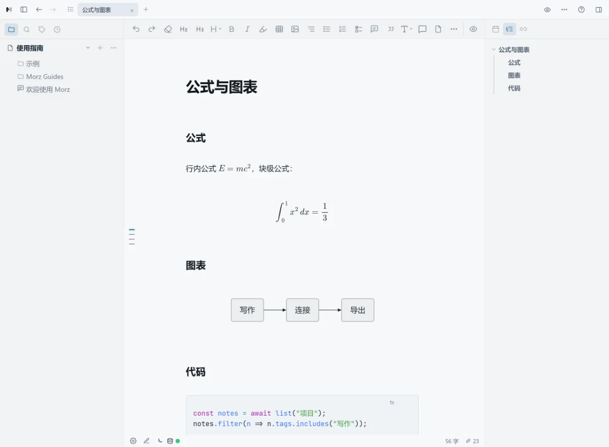
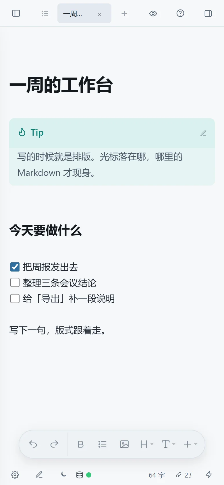

# Morz · 墨与纸

**English** · 简体中文

> **墨与纸——一个写作工具原本只需要的两样东西。**
> 写作手感对标 Typora：写的时候就是最终排版，光标落下去仍然是 Markdown 源码，不用在源码和预览之间来回切。
> 知识管理对标 Obsidian：`[[双向链接]]`、反向链接、标签、属性、大纲与图谱。
> 而你的笔记，始终是普通 `.md` 文件，Obsidian、Typora、VS Code 随时可以直接打开。

写作工具越来越重：有的手感好，却把笔记锁进私有格式或云账号；有的知识管理强，编辑起来却像在写源码。
Morz 想把这两件事放回同一张纸上——手感与连接都要，不以绑架文件为代价。

## 为什么做 Morz

[我把插件的下载量做到 210 万之后，决定做一个"什么都没有"的编辑器](docs/manual/story.md)
——一个凌晨一点交稿的晚上，三个插件、三次重启，以及本该让这一切都不必发生的编辑器。

## 不绑架你的文件

笔记就是普通 `.md`，放在你自己的文件夹里：

- 不注册、不登录，断网可用，没有服务器中转
- 不锁定格式：标准 Markdown 语法，文件历史、回收站、备份全部留在本地
- 桌面端 Rust + Tauri 2 构建（**不是 Electron**）：安装包约 9 MB，万篇笔记工作区冷启动实测 **2.93 秒**

## 三件事，一次做齐

| ✍️ 写作手感 | 🕸 知识网络 | 📱 随处可写 |
| --- | --- | --- |
| 写即排版，语法只在光标落点现身。表格、公式、Mermaid、代码块全部原位编辑，触屏也一样。 | `[[双向链接]]` 含块引用、反向链接、标签、局部 / 全局图谱、Dataview 查询、属性卡——知识层完整，文件层干净。 | 浏览器直接打开，PWA 离线安装；iPad 键盘上方有格式栏，Scribble 与听写不受影响；Windows / macOS / Linux / Android 原生安装包。 |

## 写进去，就是排出来

提示卡片、任务清单、属性、能算数的表格都在原地渲染——Markdown 只在光标落点现身。

行内 / 块级公式、Mermaid 图表、代码块同样原位编辑，离线渲染。

同一个文件在手机上：排版一致，格式栏收在拇指够得到的地方。

## 两个版本

**Morz · 免费版**

稳定核心：编辑与阅读、双链与反链、图谱、搜索、主题与插件社区。日常写作够用，长期免费。

**Morz 内测版 · 支持者席位（Insider）**

赞助开发即可进入内测席位：正在打磨的功能先出现在这里——AI 助手、章节卡片、日历与每日笔记、快速捕获等；版本更早、反馈优先处理。

内测版不承诺时间表，也不保证每个实验功能都会保留。稳定下来的功能会陆续进入免费版——支持者拿到的是「提前」，不是「独占」。

## 功能

| | |
|---|---|
| 写作 | 所见即所得；表格（原地编辑、`=SUM` 公式、排序、填充柄序列）、代码块（100+ 语言高亮）、数学公式（MathJax 4 离线渲染）、Mermaid、脚注、GitHub 式标注；章节卡片（标题分层成列、卡内直接写、全屏编辑单卡） |
| 整理 | 双向链接（含块引用）与反链、标签、属性卡、大纲、局部 / 全局图谱、每日笔记与模板、日历、收藏与最近文件、拼音命令面板 |
| 导出 | PDF（页码、目录页码、侧边书签）、Word、HTML、长图（单张 PNG 或分页 zip）；DOCX 导入与往返保真（实验特性）；表格或选中文字可复制为图片 |
| 扩展 | 插件市场与主题市场（Dataview、Tasks、AI 助手、Blue Topaz、Style Settings），安装逐文件 sha256 校验 |
| 多端 | Windows / macOS / Linux / Android；浏览器与 PWA 直接使用；iPadOS 触屏适配 |
| 数据 | 普通 `.md`、重命名 / 移动自动更新链接、图床上传（S3 / 兰台）、文件历史、回收站、一键备份 |

## 安装

内测阶段，安装包不从这里分发：

- 网页版直接可用：<https://app.morz.app>
- 桌面端（Windows / macOS / Linux）与 Android 通过内测链接获取：<https://morz.app>
- 装成应用：iPadOS 在 Safari 用「分享 → 添加到主屏幕」；桌面 Chrome / Edge 用地址栏安装图标
- 已安装版本从 **帮助 → 检查更新** 升级（国内镜像优先，GitHub 兜底）

## 下载与自动更新

- 公开发行包将包含 NSIS 安装包、minisign 签名（`.exe.sig`）与 `latest.json`。
- 安装包签名用 minisign 校验——镜像不可能注入代码。
- 便携版 `.exe` 不支持应用内自动更新；要升级请用安装包版本。

## 文档

- [帮助中心](docs/manual/README.md) — 开始使用、写作、整理、导出、设置与常见问题
- [上手指南](docs/manual/index.md) — 从首次启动到完成一篇文档，带真实截图
- [功能指南](docs/manual/features.md) — 每个菜单项解决什么问题、什么时候用
- [与 Obsidian / Typora / 幕布的对比](docs/manual/compare.md) — 能力、取舍，以及什么情况下不该选 Morz
- [插件开发](docs/PLUGIN-DEVELOPMENT.md) · [插件 SDK](docs/PLUGIN-SDK.md) · [主题开发](docs/THEME-DEVELOPMENT.md) · [Blue Topaz](docs/BLUE-TOPAZ.md) · [发布规范](docs/PUBLISHING.md) · [给 AI 的速查](llm.md)

## 插件与主题

- 插件市场：**设置 → 第三方插件**
- 主题市场：**设置 → 外观 → 主题市场**
- 索引与校验值在本仓库的 `registry/`，客户端安装时逐文件校验 sha256

## 关于这个仓库

Morz 是 Cuman 的独立项目，与 Typora、Obsidian 没有隶属关系。

## 许可

本仓库的文档与注册表采用 MIT 许可；Morz 应用本体为专有软件，详见 [LICENSE](LICENSE) 与 [THIRD-PARTY-NOTICES.md](THIRD-PARTY-NOTICES.md)。
