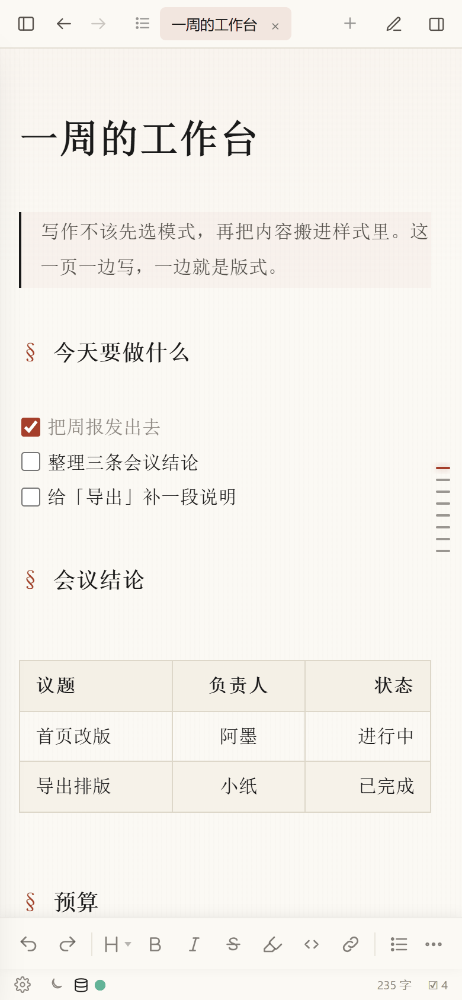

---
aliases:
  - 多端与数据
---

# 多端与数据

> 不管在哪台设备上，打开的都是同一份文件、同一种版式。

**本文目录**

- [桌面版](#桌面版)
- [手机版](#手机版)
- [文件到底在哪](#文件到底在哪)
- [多设备怎么同步](#多设备怎么同步)
- [更新渠道](#更新渠道)
- [隐私与诊断](#隐私与诊断)

---

## 桌面版

| 平台 | 安装 | 说明 |
|------|------|------|
| Windows | 下载 `.exe` 安装包 | 内置一键导出 PDF（带书签）；未签名，SmartScreen 会提示 |
| macOS | 下载 `.dmg`，拖进「应用程序」 | 未公证版本首次需右键打开 |
| Linux | `.deb` / `.AppImage` | PDF 走系统打印对话框 |

**桌面版独有的能力**：

- 打开本地文件夹（工作区、文件树、全库搜索）
- 一键导出带书签的 PDF（仅 Windows）
- 双击 `.md` 直接从系统打开（文件关联）
- 在系统文件管理器中显示文件

---

## 手机版

**两种用法**：

| 方式 | 数据在哪 | 适合 |
|------|----------|------|
| 授权一个文件夹 | 你指定的文件夹 | 想用文件管理器看到、想换手机拷走 |
| 应用内草稿目录 | 应用私有目录 | 图省事；**卸载会一起删** |

**手机上能做什么**：写、改、看、搜索、标签、主题、导出分享。工具栏是横向滚动的一行。

- **导出 PDF**：直接生成带侧边书签的 PDF，再打开系统分享面板（保存到文件 / 发给别人）
- **图片**：点图片放大查看；长按弹出菜单，可删除引用或编辑源码
- **每日笔记**：主屏小组件 / 分享进来的内容默认进今天的每日笔记
- 手机端没有「内置书架」这一层：启动后直接落在草稿目录或你授权的工作区

**建议**：如果笔记重要，选"授权文件夹"，不要用草稿目录。

---

## 文件到底在哪

| 场景 | 位置 |
|------|------|
| 桌面版打开文件夹 | 就是你选的那个文件夹，原样读写 |
| 桌面版打开单个文件 | 那个文件所在位置 |
| 浏览器 / PWA 书架 | 浏览器 IndexedDB（建议尽快转到文件夹） |
| Android 授权文件夹 | 你授权的目录 |
| Android 草稿目录 | 应用私有目录，卸载即删 |

**一句话**：Morz 不存你的笔记，它只是打开你文件夹的另一种方式。普通 `.md`，任何编辑器都能打开。

---

## 多设备怎么同步

Morz **不提供**同步。这是刻意的：同步是"谁掌握你数据"的关键决定，应该由你选。

**推荐做法**：把笔记文件夹放进你自己的同步盘。

| 方案 | 适合 |
|------|------|
| OneDrive / iCloud / 坚果云 | 普通用户，自动同步 |
| Syncthing | 想自己掌控、不走第三方服务器 |
| Git | 想要版本历史、可回滚（配合 `.gitignore` 排除大附件） |

**注意**：多个设备同时改同一个文件时，同步盘会冲突。Morz 检测到磁盘文件被外部改动时，会按 设置 › 通用 › 文件 › 「磁盘文件被外部改动时」的策略处理（询问 / 保留我的 / 重新加载）。

---

## 更新渠道

| 平台 | 怎么更新 |
|------|----------|
| Windows 桌面 | 帮助 › 检查更新（下载 → 安装 → 重启）；镜像优先，GitHub 兜底 |
| macOS / Linux | 同上（带签名校验的更新清单） |
| Web / PWA | 新版本就绪后提示刷新 |
| Android | 下载新 APK 覆盖安装（同签名、版本号递增，数据保留）；上架商店后由商店更新 |

> 更新包带 minisign 签名校验，镜像被替换也无法注入代码。

---

## 隐私与诊断

**Morz 没有用于笔记的服务器：正文、图片和附件不会上传。**

| 可能联网的操作 | 说明 |
|---|---|
| 加载应用本身 | 首次从官网 / gh-pages 下载静态资源；PWA 安装后离线可用 |
| 检查更新 / 插件市场 | 只请求版本号和插件清单（`registry/index.json`），不含笔记内容；离线时用缓存 |
| 笔记里的外链图片 | 浏览器直接向图片所在网站请求，和普通网页一样 |
| AI 助手 | 只有你点「发送」时，消息才发到你填写的 API 地址 |
| 图床插件 | 只有你主动上传图片时，才发到你配置的图床 |

**默认没有**：账号 / 登录、自动同步；文档内容不会自动上传。

网页版的数据位置：

- 书架（Library）存在**当前浏览器的 IndexedDB**；清除浏览器数据会丢失，请定期用 **文件 › 导出全部文档（备份）**；
- 用「打开文件夹」授权的目录，文件仍在你磁盘上，浏览器只按你的操作读写。

**怎么自己验证**：打开开发者工具 → Network，清空后编辑、保存、切换文档；除静态资源和上表列出的操作外，不会出现请求。

**诊断**：正常版只在本地静默记录未捕获错误与严重卡顿（不采集笔记正文、不上传）；内部测试版可在 **帮助** 菜单导出诊断 JSON（错误堆栈、版本、插件列表）。**本地使用统计**只记录功能/命令的调用次数与耗时，不含正文、路径、文件名，也不上传，随诊断导出。「允许外部 AI 客户端访问已打开的文件夹」默认关闭；开启后只在本机写一份清单（供 MCP 工具发现），关掉立即清空。

---

**下一步**：[设置详解](settings.md) · [常见问题](faq.md)
