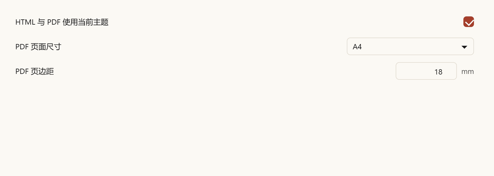

---
aliases:
  - 导出与备份
---

# 导出与备份

> 写完了，总得给别人看；写多了，总得防一手。

**本文目录**

- [三种格式怎么选](#三种格式怎么选)
- [导出 PDF](#导出-pdf)
- [导出 Word](#导出-word)
- [导出 HTML](#导出-html)
- [备份、历史与回收站](#备份历史与回收站)
- [发布为静态站](#发布为静态站)

---

## 三种格式怎么选

| 格式 | 给谁 | 能保住什么 |
|------|------|------------|
| **PDF** | 交付、打印、归档 | 分页、页码、目录页码、**侧边书签**（Windows） |
| **Word** | 需要对方能改 | 导航大纲、画廊、Callout、代码块、脚注 |
| **HTML** | 发网页、存档 | 跟随主题、图片内嵌、可直接打开 |

路径都在 **文件 › 导出**。

> 导出支持 **PDF、Word、Markdown 与备份**；也可以导出 **HTML、长图、ePub**，或把整个工作区发布成静态站。自带图床同样可用。

---

## 导出 PDF

**步骤**：

1. 文件 › 导出 › **PDF**
2. 桌面 Windows 弹保存框；Android 生成后打开系统分享面板，选「保存到文件」即可
3. 打开 PDF：页脚有「当前页 / 总页数」，阅读器侧边栏有书签

**页面设置**（设置 › 导出）：

| 设置项 | 说明 |
|--------|------|
| HTML 与 PDF 使用当前主题 | 关掉则用素色排版 |
| PDF 页面尺寸 | A4 / Letter / Legal / A5 |
| PDF 页边距 | 单位 mm |

**能做到什么**：

- `[TOC]` 条目自动填**真实页码**，带点线引导
- 书签按 H1 → H2 → H3 分层，点击跳章节
- 中文标题不乱码（写入 UTF-16BE）
- 图片居中/左/右对齐、图注和 `|nocap` 隐藏说明都会保留；画廊并排、Callout 带底色、代码块带高亮、Mermaid 转图片；Dataview/Tasks 查询导出为渲染后的表格/列表
- 边注与脚注收进文末编号脚注区

**平台差异**（重要）：

| 平台 | 能力 |
|------|------|
| Windows 桌面 | 一键生成 + 侧边书签 |
| Android | 一键生成 + 侧边书签，再走系统分享（保存到文件 / 发给别人） |
| macOS / Linux | 走系统打印对话框另存 PDF；页码与排版正常，**没有书签** |
| 浏览器 | 走系统打印；书签不可用 |

---

## 导出 Word

**步骤**：文件 › 导出 › **Word (.docx)** → 保存 → 用 Word / WPS 打开。

**会保留**：

| 内容 | 在 Word 里 |
|------|------------|
| 标题 | 真正的标题样式，Word 导航窗格能看到 H1–H6 |
| 图片 | 居中/左/右对齐、图注、隐藏说明（nocap）；显式画廊用无边框表格按标记列数排，不竖排占满页面 |
| Dataview / Tasks | 导出时执行查询，写入渲染后的表格/列表，而不是代码块 |
| Callout | 彩色左边框 + 浅色底，内部表格仍是表格 |
| 表格 | 表头底色、加粗、左中右对齐 |
| 代码块 | 灰底、等宽字体（Consolas） |
| 列表 | 真正的多级列表，嵌套序号重新从 1 开始 |
| 任务列表 | ☑ / ☐ |
| 块级公式 | 转成图片 |
| 行内公式 | 保留 TeX 文本（当前预期） |
| 边注 | 收进文末脚注 |

---

## 导出 HTML

两种：

- **HTML**：完整网页，带当前主题与图片（data URL 内嵌），双击即可看
- **HTML（无样式）**：只有结构，适合贴进已有站点

另外「复制为 HTML 代码」把内容直接放进剪贴板，粘到邮件或公众号后台时样式不丢。

---

## 备份、历史与回收站

| 功能 | 位置 | 解决什么 |
|------|------|----------|
| **导出全部文档（备份）** | 文件 › 工作区 | 换电脑/重装前打包整个书架（zip） |
| **文件历史** | 文件 › 文件历史… | 改坏了按时间点找回旧版本；条数与保留天数在 设置 › 通用 |
| **回收站** | 文件 › 工作区 | 误删恢复 |
| **另存为** | 文件 | 另起一份，原稿保留 |

> **建议**：重要文档除了历史，再配一份外部备份（同步盘或 Git）。Morz 不做云端，备份需要你自己掌控。

---

## 发布为静态站

**步骤**：文件 › 导出 › **发布为静态站…** → 选目录 → 得到一个可直接上传的站点文件夹（HTML + 资源）。

适合：把一组笔记作为文档站发到静态托管（GitHub Pages、Netlify、对象存储）。

**导出范围**：**当前工作区的全部 Markdown 文档**，不是只导当前这一篇；每篇生成一个 `<原文件名>.html`，另有首页 `index.html`、`assets/style.css` 和搜索索引，所以库内互链在站内都有落点。

**站内链接怎么处理**：

- `[[笔记]]`、`[[笔记|别名]]`、`[[笔记#标题]]` → 对应页面的相对链接（标题带锚点）
- `[文字](notes/b.md)`、`[文字](../a.md)` → 改写成 `.html` 相对路径
- 找不到目标的链接、指向图片/PDF 等附件的链接 → 去掉链接、显示为不可点文字，不会变成 404
- 外链、页内 `#` 锚点保持原样

> 附件文件本身不会复制进站点；需要一起发布时，先手动放进输出目录。

---

**下一步**：[多端与数据](devices.md) · [常见问题](faq.md)
