---
aliases:
  - 手记
---

# 墨与纸 · 一个 Markdown 编辑器的手记

> **版本**：v0.1.0 · 2026-11-08
> **写给**：正在找一款"能安心写字"的编辑器的你
> **配图**：`assets/` 内是真实界面截图；两张示意图用 Mermaid 写在正文里
> **另一份**：按任务查操作看 [帮助中心](README.md)；按菜单逐项查功能看 [功能指南](features.md)

---

## 一、我为什么做这个

我叫 cuman。参与维护 Blue Topaz 主题，做的 Blue Topaz example 拿到 2.6K star；开发的 Editing Toolbar 插件有 210 万次下载，常年排在下载榜前二十；还有 Floating TOC 这些；PKMer 知识库一万多篇文章，全部开源。

我大概是这套生态里最不该说它坏话的人。但也正因为待得够久，我最清楚它的上限。

凌晨一点，我为了把一篇笔记导出成 Word，在插件市场里翻了四十分钟——不是没有插件，是插件太多。那一刻我意识到：我维护的不是笔记，是一套系统。

我们花了十年，把 Markdown 变成一件需要"配置"的事：主题、插件、快捷键、CSS、工作区布局。每个人打开同一个文件夹，看到的是不同的软件。格式本身也是割裂的——源码一套，阅读一套，同一段字在两个视图里长得不一样。

可大多数人只是要记点东西，不是来折腾工具的。

于是很多人去了 Typora，因为简单。可文档一多它管不动，你习惯的双链它也不认。最后两个软件并存：Typora 写，Obsidian 存，甚至有人开 VS Code 管 md。工具越来越重，重到你开始为它服务。

我一直觉得，笔记应该像书。同样的内容，换个出版社，版式一乱，读起来的感觉就变了，思绪也跟着乱。你只想找到那本最熟悉的书——纸微微发黄，有淡淡的书香，翻开就是你的字。

所以有了 Morz，墨与纸：**繁归于简，墨落于纸。**

打开就是版式，表格能算，导出能交差，文件还是你的 `.md`，轻且全端，常用的全在里面。

我不反对插件。我反对的是：为了一个本来很简单的需求，先学会一套生态。

完整的故事在 [故事](story.md) 里。

---

## 二、它长什么样

先不谈功能，看三张图就够了。

这是桌面版的写作界面。左边是文件夹，中间是正文，右边是这篇的大纲。你看到的标题、任务清单、表格，就是最终的版面——没有"编辑 / 预览"两套东西。

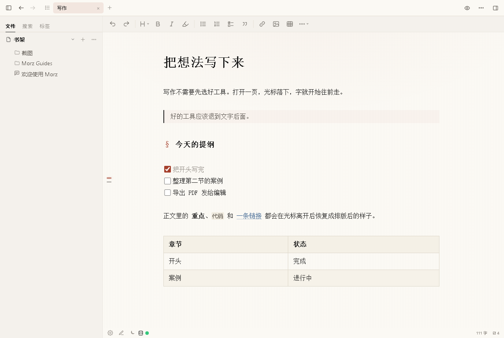

晚上写东西，一键切深色。正文、表格、侧栏一起换，不是给正文盖一层黑纱：

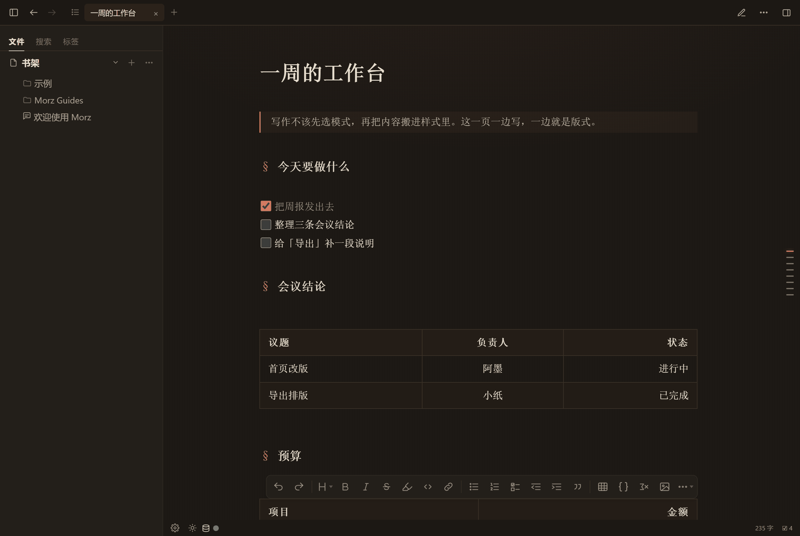

手机上打开同一篇，版式还在，工具栏收成一行：

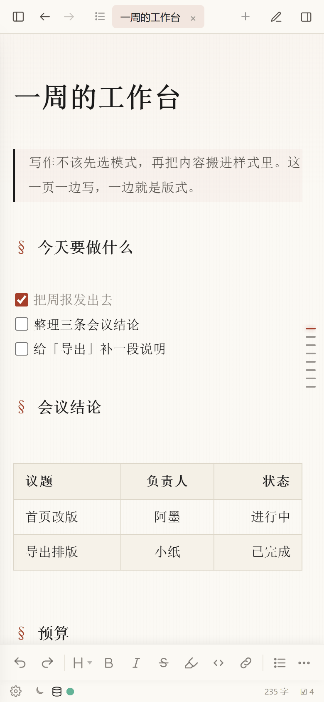

如果你只想知道"好不好看"，到这里就够了。下面讲怎么用。

---

## 三、第一次打开

第一次启动，你只会看到一个页面：

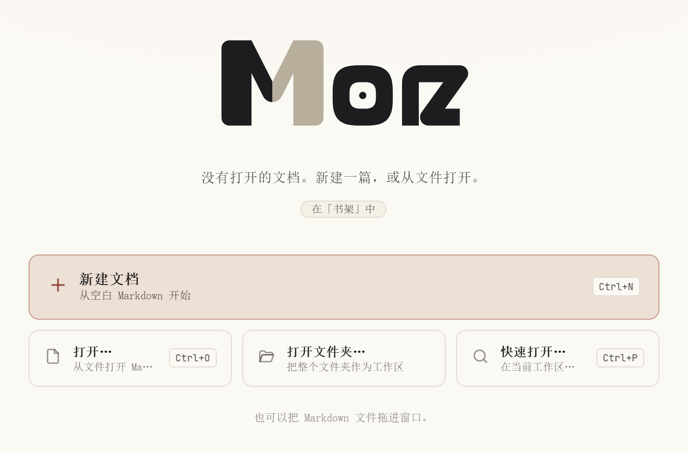

大多数人会犹豫：是"打开…"还是"打开文件夹…"？

**我的建议永远是后者。**

选一个你放笔记的文件夹——注意是文件夹，不是单个文件。这一步决定了后面所有体验：Morz 会把整个文件夹当成一个**工作区**，左边列出里面所有的 `.md` 和子文件夹，点一下就打开，切文件不丢位置。

打开单个文件也能用，但它就像在没有地址的地方写信：能写，只是随时会找不到邻居。

进去之后，先记住四件事，别的都可以慢慢发现：

1. **回车就是换行。** 源码里只多一个换行符，你看到几行，源码就是几行。
2. **空一行才是新段落。** 连按两次回车。
3. **`Shift+回车`** 是段内硬换行。
4. **`Ctrl+Z` 撤销。** 在表格里，它的行为比一般编辑器聪明一点（后面会讲）。

> 说个设计上的取舍：很多编辑器按一次回车就给你插一个空行，视觉上"跳两行"，源码里也真的多了一行空行。我一开始也这么做，后来发现它让"我写的"和"我看到的"对不上——于是改成了现在这样：**所见即所得，逐行一致**。

---

## 四、写字的手感

### 4.1 格式不用记

选中一句话，`Ctrl+B` 加粗，`Ctrl+I` 斜体，`Ctrl+K` 加链接。行首敲 `# ` 是标题，`- ` 是列表，`> ` 是引用——和你用过的编辑器一样。

不一样的是**链接**。设置里可以选两种写法：

- **Markdown**：`[文字](https://…)`，标准写法，任何地方都认；
- **双链**：`[[页面名]]`，适合库内互链，点一下跳过去，目标文档里还能看到"谁引用了我"。

从 Obsidian 过来的朋友把这一项切成"双链"，写出来的东西在两边都能用。

### 4.2 那些"看起来很麻烦"的块

| 你想写 | 敲什么 |
|--------|--------|
| 代码 | 三个反引号 + 语言名 |
| 公式 | `$$` 换行写 TeX 再 `$$`；行内用 `$E=mc^2$` |
| 提示卡片 | `> [!TIP]` 换行写内容 |
| 边注 | `^[一句话]` |
| 任务 | `- [ ]` / `- [x]` |

边注这个功能值得多说一句。写文章时经常有"这句要解释一下，但放进正文会打断节奏"的内容——`^[...]` 让它出现在页边。**导出 PDF 或 Word 时，它会自动收进文末编号脚注**，信息不丢，版面不乱。

---

## 五、表格：终于能算数了

我对表格的执念，来自每个月做一次的开销表。

以前在 Markdown 里做这件事是这样的：手数竖线、对齐、改一个数字要重排整行，想求和？切到 Excel，算完再抄回来。

Morz 的表格是**能算的**：

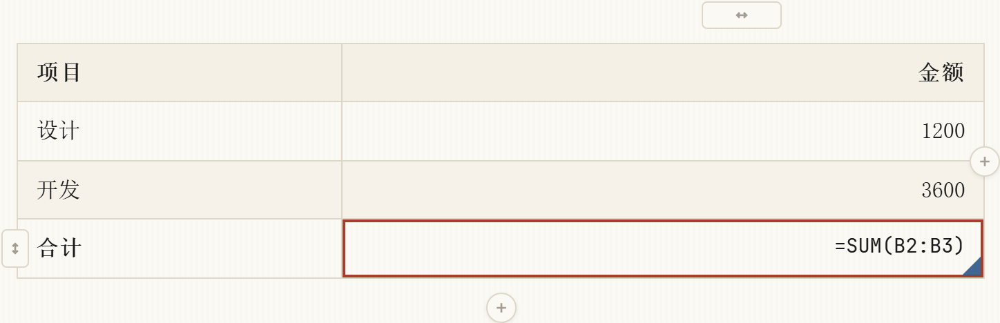

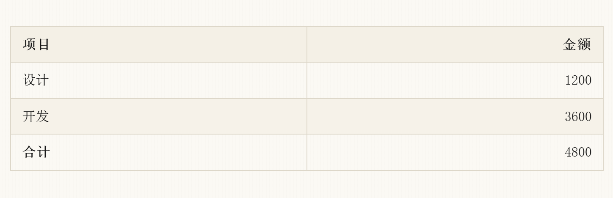

在任意格子里敲 `=SUM(B2:B3)`，移开光标就是结果。`=AVERAGE(...)`、四则运算、括号、多区域都支持。

更省事的是**序列填充**：点中一个写着 `1` 或 `2026-01-01` 的格子，按住右下角的小三角往下拖——数字、日期、星期、月份会自己续上。Excel 里有的那几种序列，这里都有。

还有几个用过就回不去的细节：

- 按 `Tab` 跳到下一格，最后一格按 `Tab` **自动加一行**；
- 按住拖过多个格子，形成选区，`Ctrl+C` / `Ctrl+V` 可以整块搬到 Excel 再搬回来；
- 正在编辑的格子按 `Ctrl+Z`，**整格**回到你刚进这格的样子，而不是一个字一个字地退；
- 拖过填充柄再 `Ctrl+Z`，一次撤销整次填充。

第二条是我最常用的：从网页上拷一张表，直接粘进文档，不用再手动拼竖线。

---

## 六、一篇长文是怎么长出来的

写到第三十个文档，问题往往不再是"怎么写"，而是"东西放在哪"。

### 6.1 先有一张桌子

Morz 的侧栏顶部可以切换工作区。工作区就是你打开的那些文件夹：一个是"工作"，一个是"读书"，一个是"自己的东西"。

关键是：**每个工作区会记住自己的现场。**

上次在看哪一篇、右侧面板开着什么、分成了几个区、左边停在文件还是标签、两侧拖过多宽——切走再切回来，桌子还是你离开时的样子。

这一点在"上午写方案、下午整理读书笔记"的日子里特别省心，不用每次重新摆一遍。

### 6.2 标签页：能重排，也能找回来

标签可以拖着换顺序，顺序会跟着会话留下。

点标签条最左边的列表按钮，会展开所有打开的标签，每一项右侧写着它**多久没被碰过**：

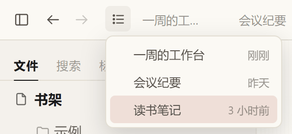

这个相对时间是给我自己看的——翻的时候一眼就知道哪篇是三天前开的、可以关了。

手滑关错了？同一个列表最上面有「**撤销关闭：文件名**」，点一下，文档回到它原来的位置，不是丢到最后一个。

### 6.3 右栏可以拆成上下两半

写长文时，我经常一边看大纲一边看这篇引用了谁。以前只能来回切面板。

现在把「出链」标签拖到右栏的下半区，就分成两个区，各有各的标签条；中间的分隔条可以拖，调比例。

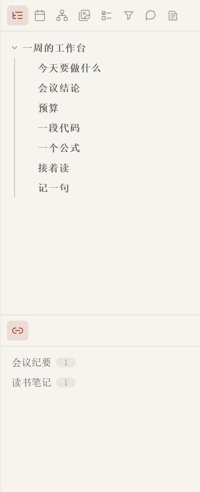

关掉某个区最后一个面板，那个区会自己收起来，但整个右栏不会跟着消失——它在原地留一句话：「右键此处添加面板」。右键空白处，勾选你要的面板就挂回来了。

### 6.4 找东西的四种方式

| 你记得什么 | 用什么 |
|------------|--------|
| 标题 | `Ctrl+O` 快速打开 |
| 正文里的某句话 | `Ctrl+Shift+F` 在文件中搜索 |
| 给它打过的标签 | 左侧「标签」 |
| 它和谁有关系 | 双击 `[[双链]]`；在那篇里看反链 |

---

## 七、让它好看（这一段我想多说点）

我承认，主题这件事上我有私心：**一个每天要待几个小时的地方，应该顺眼。**

Morz 内置七套主题，每套都有明暗两版：墨与纸、峡湾、索引卡、报刊、夜色、石墨、终端。

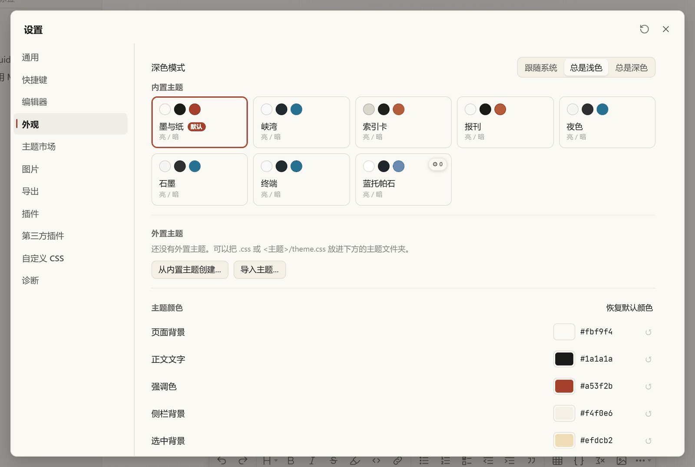

**蓝托帕石**（Blue Topaz）则是官方市场主题：设置 › 外观 › **主题市场** 安装。

它是社区主题的改编版，我保留了它的视觉签名——托帕蓝、蓝色系标题梯度、带色引用、圆角代码卡——同时让它可以被"调"。装好后，蓝托帕石卡片上的齿轮会打开一页主题设置：

- **六套配色**：默认·蓝宝、极简、牛油果、蜂蜜牛奶、榛子巧克力、秋；每套都有对应的暗色变体，不是简单反色；
- **字体与节奏**：正文字体、界面字体、等宽字体、行高、标题行高；
- **纸张**：写作区底色、背景图、可读性遮罩；
- **侧栏**：甚至可以给侧栏单独放一张背景图。

换个配色再换张背景，就是完全另一间书房。下面两张是真实使用中的配置，一张暗一张亮——同一篇文档，同一天：

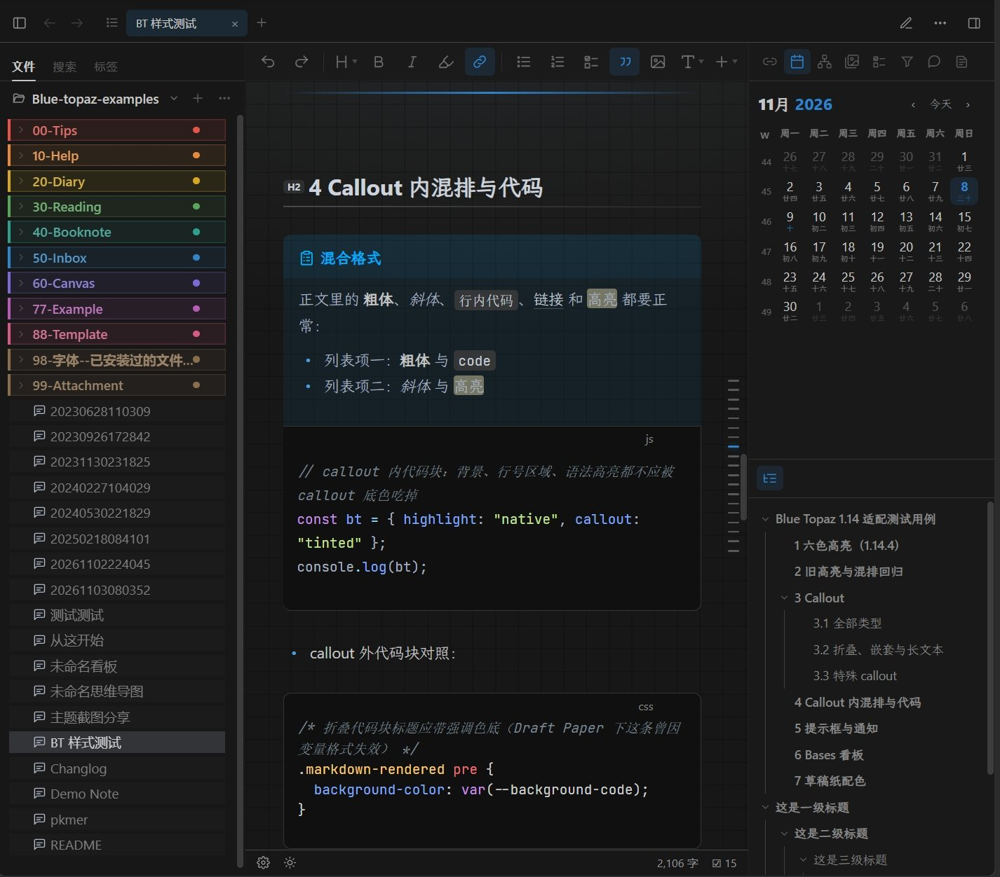

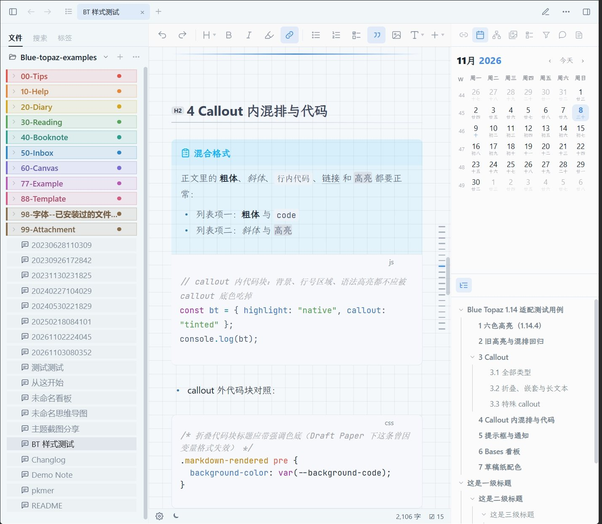

如果你用的是别的 Obsidian 主题，也可以把主题文件夹指过去（里面要有 `theme.css` 和 `manifest.json`），Morz 会通过兼容层加载。想自己改，就用「从内置主题创建…」复制一份出来，改 CSS。

同一条路还能调舒服度：字号、行宽、行高，正文里 `Ctrl+滚轮` 直接缩放；`F8` 专注模式只亮当前段；打字机模式让输入行始终停在屏幕中间（默认不绑快捷键，怕误触，你可以在快捷键设置里自己加）。

---

## 八、交出去

写完了，总得给别人看。

**文件 › 导出** 里有三种：

**PDF**——这是桌面版和 Android 最值得炫耀的一项。它会真的分页：页脚有「当前页 / 总页数」，`[TOC]` 条目自动填上真实页码，PDF 阅读器的侧边栏里有**书签**，H1 → H2 → H3 分层，中文不乱码。发给同事，对方能直接跳章节。Android 上生成后直接分享出去。

**Word (.docx)**——Word 导航窗格里能看到大纲层级；图片画廊是并排的，不是一张一张竖着排满整页；Callout 保留左边框和浅底；代码块是灰底等宽字体；边注收进文末脚注。

**HTML**——跟随当前主题，图片内嵌，适合发网页或存档。

页面尺寸和页边距在 设置 › 导出 里：

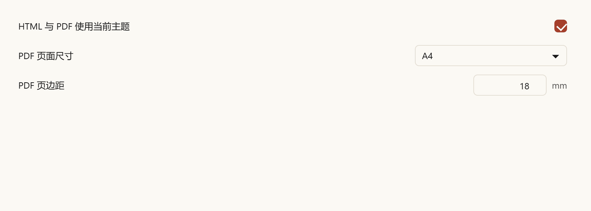

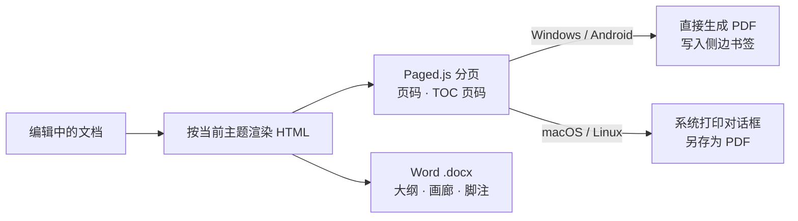

**图 13 · 导出链路**：同一份内容，按目标格式换"排版后端"，而不是各写一套样式。

说句实话：**带书签的 PDF 目前只有 Windows 桌面和 Android 完整支持**。macOS 和 Linux 走系统打印对话框，页码和排版正常，但没有侧边书签。这是平台能力差异，我没打算含糊过去。

---

## 九、手机上

同一篇文档在手机上，就是前面那张图 3 的样子：排版一致，工具栏收成一行。

手机端有两种用法：

1. **授权一个文件夹**（Android）：文件就在那里，用文件管理器能看到，换手机拷过去就能继续；
2. **应用内草稿目录**：省事，但卸载应用会一起删掉，记得先导出备份。

---

## 十、你的文件在哪

这是我最不想含糊的一段。

**没有云端，没有账号，没有"同步服务"。** 桌面版打开文件夹，改一次写一次，写的就是你磁盘上那个 `.md`。

想要多设备，把文件夹放进你自己的同步盘——OneDrive、iCloud、坚果云、Syncthing、Git 都行。Morz 只是读写的另一方，不介入同步，也不碰你的网盘。

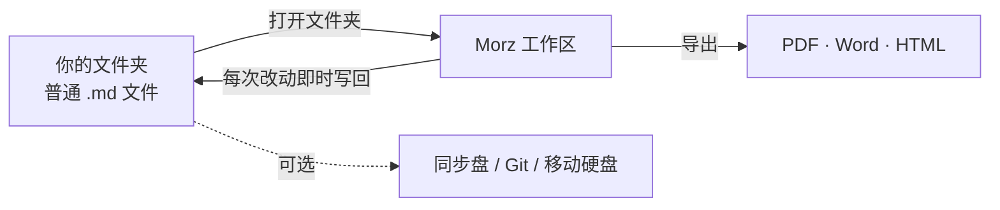

**图 14 · 文件模型**

几条配套的安全网：

- **文件 › 导出全部文档（备份）**：整个书架打包带走；
- **文件历史**：每篇保留多个版本快照，条数和保留天数可调；
- **回收站**：删掉的笔记先进回收站；
- **本地错误日志**：只写本机，不采集笔记正文、不上传。

关于隐私只有一句：**它不需要知道你是谁。** 没有登录，不会自动上传文档内容；「允许外部 AI 客户端访问已打开的文件夹」默认关闭，开启后也只在本机生成一份清单，关掉立即清空。

---

## 十一、和 Obsidian、Typora 比

我知道你在想什么：**已经有那两个了，为什么还要试这个？**

| | Obsidian | Typora | Morz |
|---|---|---|---|
| 写作即版式 | 接近，仍有源码片段 | 是，标杆 | 是，逐行一致 |
| 文件 | 本地 `.md` | 本地 `.md` | 本地 `.md` |
| 价格 | 个人免费，商用授权 | 付费 | 免费使用（内测），含商用 |
| 插件生态 | 极强 | 无 | 内置 + SDK（起步） |
| 双链 / 反链 / 块引用 | 强项 | 基本无 | 有 |
| Dataview 查询 | 完整社区生态 | 无 | 内置 DQL 子集 + `dataviewjs` |
| 表格 | 基础 | 基础 | **公式 · 填充 · 选区 · 整格撤销** |
| 导出 PDF | 插件 | 有 | **页码 + TOC + 书签**（Windows / Android） |
| 导出 Word | 插件 | 无 | **大纲 + 画廊 + 脚注** |
| 手机 | 有 | 无 | Android / PWA |

更细的逐项对比、各自强项和迁移注意事项，见 **[竞品对比](compare.md)**。

也说说**什么时候别选 Morz**：

- 你要完整的 Dataview 生态、Excalidraw、几千个社区插件——现在仍然是 Obsidian 的天下；
- 你要多人协作、评论、云端回收站——Morz 不做云端；
- 你要在 Mac / Linux 上一键导出带书签的 PDF——目前不行。

如果你恰好要的是：**所见即所得、文件归自己、表格能算、导出能交差、手机也能写、还免费**——那我们大概是同一类人。

---

## 十二、从 Obsidian / Typora 搬过来

搬家比想象中简单，因为**不用导入**：

1. 直接用 Morz 打开你原来的 vault 文件夹；
2. `[[双链]]`、`#标签`、`![[嵌入]]` 都原生支持；
3. `==高亮==`、上下标这些 Typora 写法也认；
4. 主题：内置七套够用，更多去 设置 › 外观 › **主题市场**（蓝托帕石在那里），或者把 Obsidian 主题文件夹指给 设置 › 外观 › 主题文件夹；
5. **插件不通用**——Morz 有自己的插件 SDK，Obsidian 插件需要重写。

快捷键大体一致，几个容易记混的：

| 动作 | Obsidian | Typora | Morz |
|------|----------|--------|------|
| 源码 / 实时切换 | `Ctrl+E` | `Ctrl+/` | `Ctrl+/` |
| 快速打开 | `Ctrl+O` | — | `Ctrl+O` |
| 命令面板 | `Ctrl+P` | — | `Ctrl+P` |
| 全库搜索 | `Ctrl+Shift+F` | — | `Ctrl+Shift+F` |

冲突了就以 Morz 为准——所有命令都能在 设置 › 快捷键 里重新绑定。

---

## 附录 A · 快捷键

| 动作 | Windows / Linux | macOS |
|------|-----------------|-------|
| 新建 / 打开 / 保存 | `Ctrl+N` / `Ctrl+Shift+O` / `Ctrl+S` | `⌘N` / `⌘⇧O` / `⌘S` |
| 关闭文档 | `Ctrl+Alt+W` | `⌘⌥W` |
| 撤销 / 重做 | `Ctrl+Z` / `Ctrl+Shift+Z` | `⌘Z` / `⌘⇧Z` |
| 查找 / 替换 | `Ctrl+F` / `Ctrl+H` | `⌘F` / `⌘H` |
| 在文件中搜索 | `Ctrl+Shift+F` | `⌘⇧F` |
| 快速打开 | `Ctrl+O` | `⌘O` |
| 命令面板 | `Ctrl+P` | `⌘P` |
| 加粗 / 斜体 / 链接 | `Ctrl+B` / `Ctrl+I` / `Ctrl+K` | `⌘B` / `⌘I` / `⌘K` |
| 行内代码 | `Ctrl+Shift+\`` | `⌘⇧\`` |
| 高亮 | `Ctrl+Shift+H` | `⌘⇧H` |
| 标题 1–6 / 正文 | `Ctrl+1`…`Ctrl+6` / `Ctrl+0` | `⌘1`…`⌘6` / `⌘0` |
| 引用 | `Ctrl+Shift+Q` | `⌘⇧Q` |
| 无序 / 有序列表 | `Ctrl+Shift+]` / `Ctrl+Shift+[` | `⌘⇧]` / `⌘⇧[` |
| 任务列表 | `Ctrl+Alt+X` | `⌘⌥X` |
| 源码 / 实时切换 | `Ctrl+/` | `⌘/` |
| 阅读模式 | `Ctrl+E` | `⌘E` |
| 专注模式 | `F8` | `F8` |
| 放大 / 缩小 / 还原 | `Ctrl+Shift+=` / `Ctrl+Shift+-` / `Ctrl+Shift+0` | 同左，用 `⌘` |
| 正文缩放 | `Ctrl+滚轮` | `⌘+滚轮` |
| 表格下一格 / 下一行 | `Tab` / `Enter` | 同左 |
| 表格插入行 | `Ctrl+Enter` | `⌘+Enter` |

打字机模式默认没有快捷键——怕你误触；需要的话自己去绑。

---

## 附录 B · 常被问到的问题

**会偷偷上传我的笔记吗？**
不会。没有账号系统，也没有云端。唯一联网的是更新检查和插件市场，和你的笔记内容无关。

**换电脑怎么办？**
把文件夹拷过去，或者用同步盘；在新电脑上打开同一个文件夹。主题、快捷键这些偏好要重新配，或者从旧设备的备份里恢复。

**能同时开两个文件夹吗？**
能，它们是两个工作区，侧栏顶部切换。各自记住自己的标签页、面板布局和上次看到哪。

**导出的 PDF 为什么没有书签？**
书签在 Windows 桌面版和 Android 上生效（直接生成 PDF）。macOS / Linux 走系统打印，页码正常，书签没有。

**手机上的文件在哪？**
授权过文件夹就在那个文件夹里；用草稿目录的话，卸载应用会一起删，先导出备份。

**表格支持哪些公式？**
现在有 `SUM`、`AVERAGE`、四则运算和括号，函数会继续加。序列填充支持数字、日期、星期、月份。

**误关了标签或面板？**
标签：点「所有标签」，最上面一条「撤销关闭」。面板：右栏空白处右键，重新勾上。

---

## 附录 C · 配图索引

| 图号 | 画面 | 在正文哪一节 |
|------|------|--------------|
| 图 1 | 写作界面（正文 / 任务 / 表格 / 大纲） | 二 |
| 图 2 | 深色外观 | 二 |
| 图 3 | 手机端 | 二、九 |
| 图 4 | 首次打开的空白页 | 三 |
| 图 5 | 单元格编辑态：公式源文 + 填充柄 | 五 |
| 图 6 | 同一格的公式结果 | 五 |
| 图 7 | 所有标签列表（相对时间） | 六 |
| 图 8 | 右栏上下分区 | 六 |
| 图 9 | 七套内置主题 | 七 |
| 图 10 | 蓝托帕石 · 暗色配置 | 七 |
| 图 11 | 蓝托帕石 · 亮色配置 | 七 |
| 图 12 | 导出设置 | 八 |
| 图 13 | Mermaid 示意图 · 导出链路 | 八 |
| 图 14 | Mermaid 示意图 · 文件模型 | 十 |

---

## 附录 D · 最后一句

如果你只需要一件事——**插件生态**，去 Obsidian；**纯粹的沉浸写作、不介意付费**，去 Typora。

如果你要的是：**写的时候就是版式，文件永远是你的，表格能算，写完能交差，手机也能写，还不要钱**——那就留下来试试。

有 bug、有想要的功能，欢迎告诉我。用得还行的话，也欢迎告诉别人。

— 墨与纸
