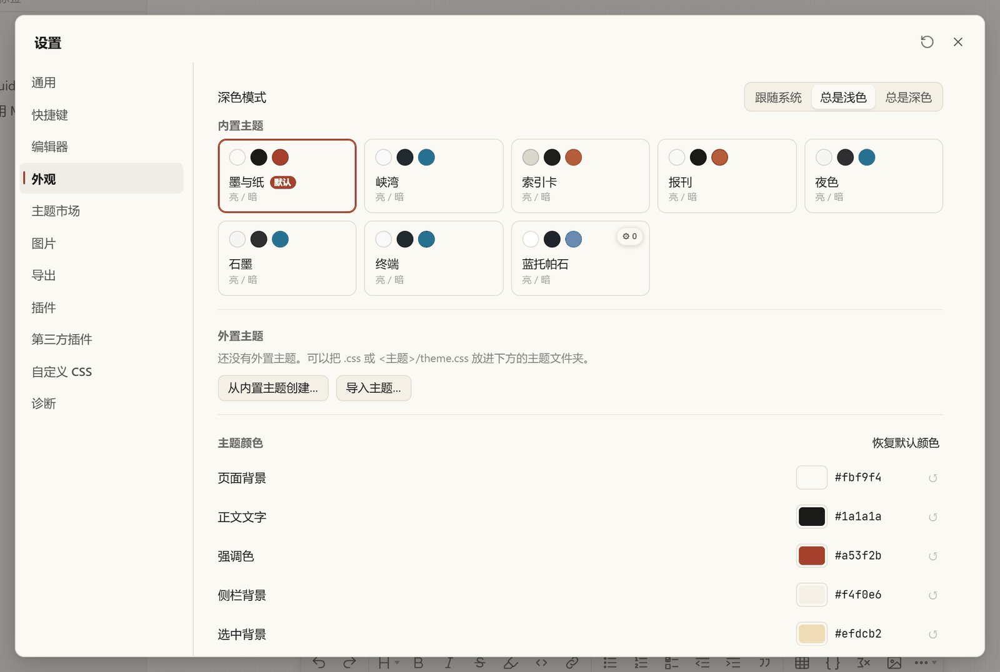
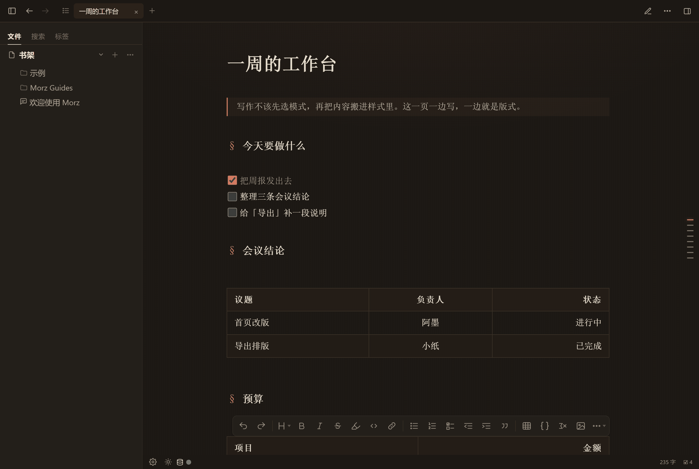
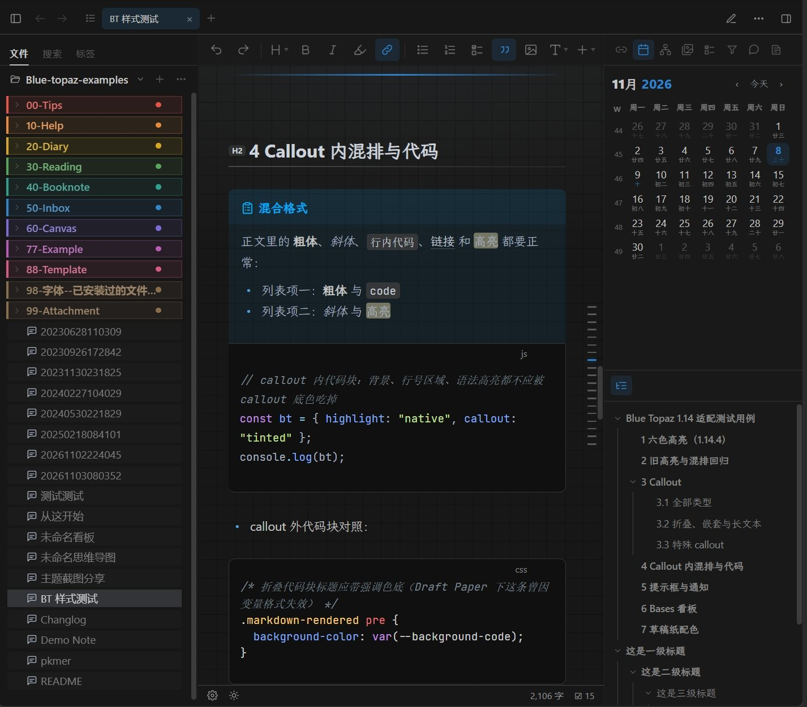
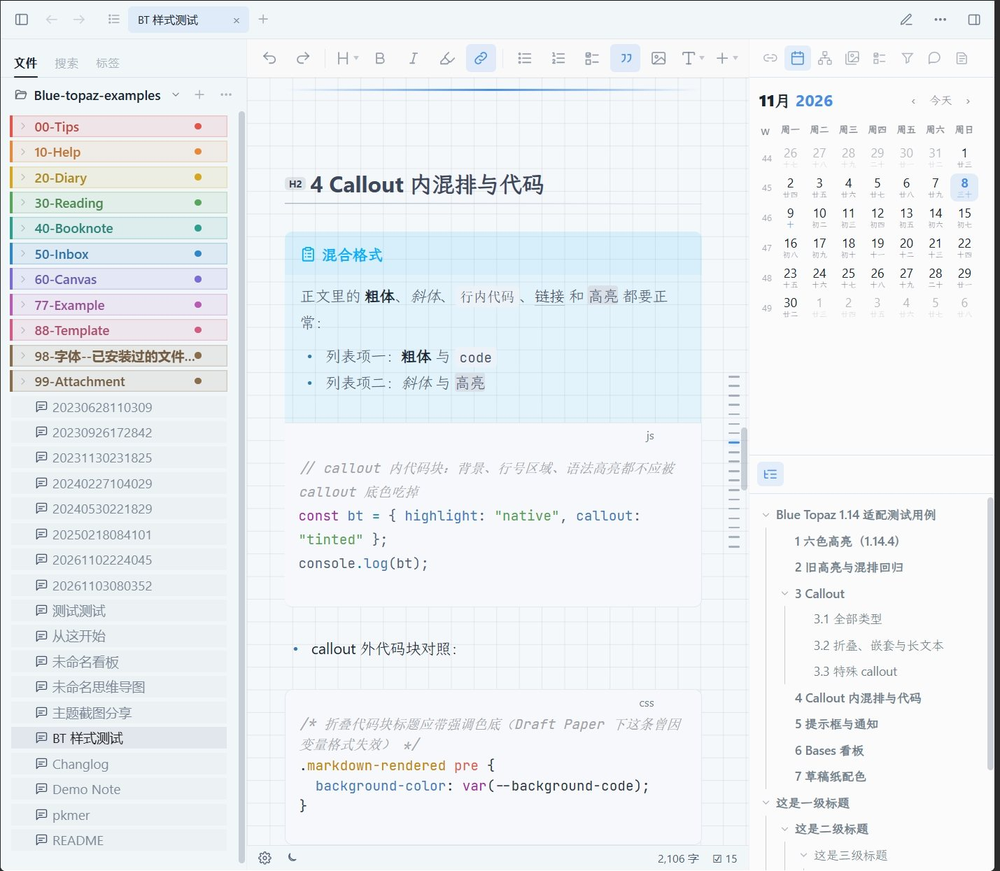
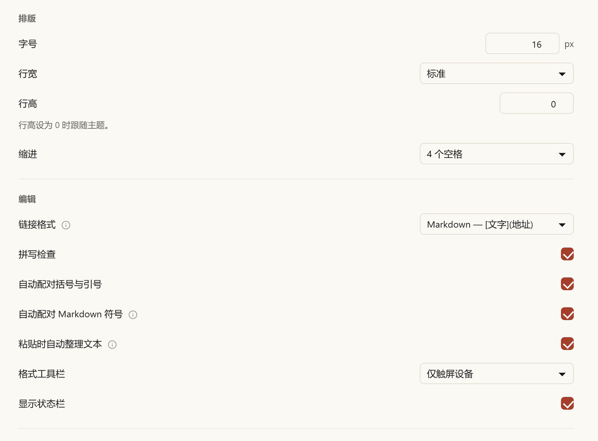
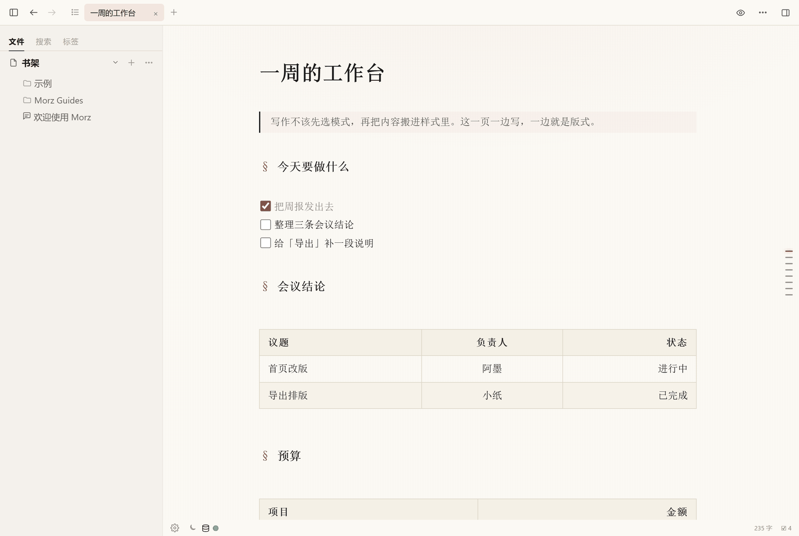
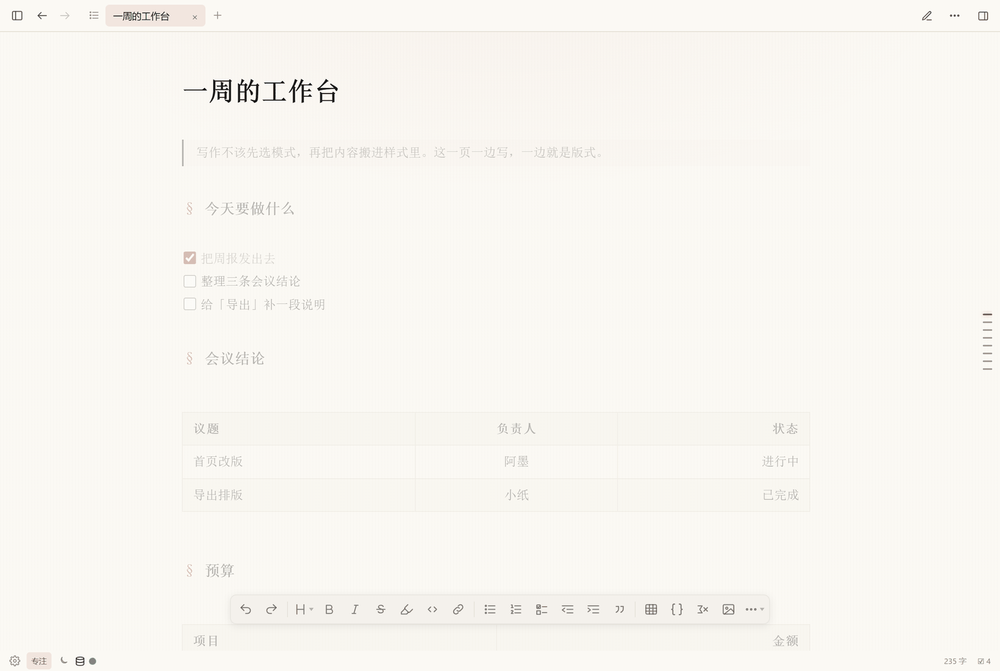
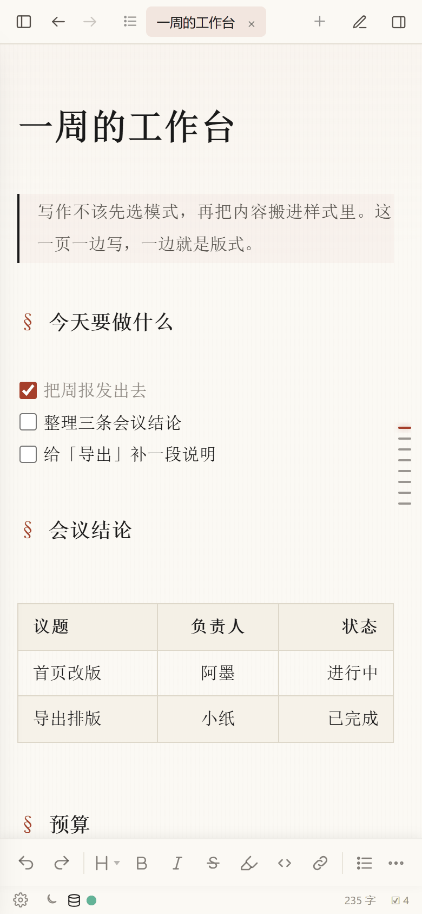

---
aliases:
  - 外观与阅读
---

# 外观与阅读

> 一个每天要待几个小时的地方，值得调舒服一点。

**本文目录**

- [内置主题](#内置主题)
- [蓝托帕石：可以调的六套配色](#蓝托帕石可以调的六套配色)
- [排版：字号、行宽、行高](#排版字号行宽行高)
- [三种视图：预览 / 源码 / 阅读](#三种视图预览--源码--阅读)
- [专注模式与打字机模式](#专注模式与打字机模式)
- [手机上的观感](#手机上的观感)

---

## 内置主题

**在哪**：设置 › 外观。八套主题各有明暗两版：墨与纸、峡湾、索引卡、报刊、夜色、石墨、终端、蓝托帕石。

**明暗模式**：顶部三选——跟随系统 / 总是浅色 / 总是深色。

同一篇文档的深色外观：

> **提示**：状态栏的月亮/太阳按钮可以一键切明暗，不用进设置。

---

## 蓝托帕石：可以调的六套配色

**是什么**：Blue Topaz 社区主题的改编版，保留托帕蓝、蓝色系标题梯度、带色引用、圆角代码卡，同时开放了主题设置。

**怎么进**：设置 › 外观 › 蓝托帕石卡片右上角的**齿轮**。

**能调什么**：

| 分组 | 选项 |
|------|------|
| 配色 | 六套：默认·蓝宝、极简、牛油果、蜂蜜牛奶、榛子巧克力、秋（每套都有暗色变体） |
| 字体 | 正文字体、界面字体、等宽字体 |
| 节奏 | 行高、标题行高 |
| 纸张 | 写作区底色、背景图、可读性遮罩 |
| 侧栏 | 侧栏背景图 |

同一篇文档，暗色与亮色两种配置：

> **换个思路**：先挑配色，再决定要不要背景图。配色决定整体气质，背景图只在"想造一个书房"的时候加。

**用别人的 Obsidian 主题**：设置 › 外观 › 主题文件夹 → 指向含 `theme.css` 与 `manifest.json` 的目录。默认目录是 `<应用数据目录>/themes`（三个系统的具体路径见 [设置详解 › 主题与插件文件夹](settings.md#主题与插件文件夹)）；把主题子目录丢进去也会自动刷新。想改内置主题，用「从内置主题创建…」复制一份。

---

## 排版：字号、行宽、行高

| 设置项 | 建议 |
|--------|------|
| 字号 | 14–18px；也可以在正文里 `Ctrl+滚轮` 直接缩放 |
| 行宽 | 纯写作选「标准」；要对照资料、看表格选「宽」 |
| 行高 | 0 = 跟随主题；长文可以设 1.7–1.8 |
| 缩进 | 2 或 4 空格，影响列表层级与代码缩进 |

---

## 三种视图：预览 / 源码 / 阅读

状态栏最左侧的按钮显示**当前状态**，点一下弹出三选菜单。状态栏本身可以右键隐藏，用「视图 › 状态栏」恢复；更新提示在标题栏，不依赖状态栏。

| 视图 | 适合 | 特点 |
|------|------|------|
| 实时预览 | 日常写作（默认） | 所见即所得，光标所在行露出源码片段 |
| 源码 | 检查 Markdown、批量替换 | 纯文本，语法高亮 |
| 阅读 | 只读浏览 | 工具栏隐藏、表格静态、链接可点 |

快捷键：`Ctrl+/` 切换实时预览/源码，`Ctrl+E` 切换阅读模式。

阅读模式下：

---

## 专注模式与打字机模式

**专注模式**（`F8`）：只亮当前段落，其余淡化。适合"只想把这段写完"。

**打字机模式**：输入时光标行始终停在屏幕中间，视线不用上下找。

- 默认**没有**快捷键（避免误触），需要的话在 设置 › 快捷键 里自己绑
- 开启后状态栏会出现对应标记，点一下即可关闭

> 两种模式都是"看不出来的开关"，所以状态栏会明确标出当前开着什么。

---

## 手机上的观感

- 版式与桌面一致（同一份主题、同一套排版规则）
- 工具栏收成一行，可左右滑动
- 侧栏是抽屉式，点左上角图标打开
- 手机上也能调字号与主题（设置 › 外观 / 编辑器）

---

**下一步**：[导出与备份](export.md) · [多端与数据](devices.md) · [设置详解](settings.md)
