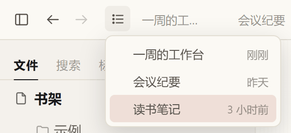
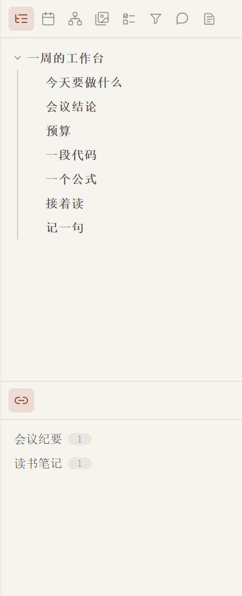

---
aliases:
  - 整理与查找
---

# 整理与查找

> 文档多了之后，难点从"怎么写"变成"东西放在哪"。

**本文目录**

- [工作区：一个文件夹一个世界](#工作区一个文件夹一个世界)
- [工作区现场：切走再回来，桌子还在](#工作区现场切走再回来桌子还在)
- [标签页：重排、找回、看时间](#标签页重排找回看时间)
- [搜索与快速打开](#搜索与快速打开)
- [右侧面板：上下分区](#右侧面板上下分区)
- [标签与反向链接](#标签与反向链接)
- [文件整理](#文件整理)

---

## 工作区：一个文件夹一个世界

**是什么**：打开一个文件夹 = 打开一个工作区。侧栏顶部可以在工作区之间切换。

**适合什么场景**：工作笔记、读书笔记、个人项目各自一个文件夹；不用把所有东西塞进一个库。

| 操作 | 位置 |
|------|------|
| 打开新工作区 | 文件 › 打开文件夹… |
| 切换工作区 | 侧栏顶部的文件夹名（或名称旁的箭头） |
| 管理工作区 | 命令面板搜"管理工作区"（重命名、移除） |

> **提示**：外部双击打开的 `.md` 怎么落位，可以在 设置 › 通用 › 文件 里选「智能判定 / 文件优先 / 按工作区」。

---

## 工作区现场：切走再回来，桌子还在

**是什么**：每个工作区会记住自己的现场，切回来时原样恢复。

**记住哪些东西**：

- 上次在看哪一篇
- 右侧面板开着什么、分成了几个区
- 左侧栏停在「文件 / 搜索 / 标签」哪一页
- 左右两侧的宽度

**什么时候有感**：上午写方案、下午整理读书笔记；或者几个项目来回切。不用每次重新摆一遍。

---

## 大纲视图与每日笔记

**每日笔记**：在 设置 › 通用 › 每日笔记 里选文件夹、文件名格式（默认 `YYYY-MM-DD.md`）和模板；右栏「日历」点日期，或命令面板搜「打开今天的笔记」。新建出来是一个空 bullet，打开就能直接输入。

**大纲视图**（每日笔记默认使用）：只允许列表，像幕布一样逐层展开。

| 操作 | 怎么做 |
|------|--------|
| 折叠 / 展开 | 桌面端是项目符号左侧的小三角；触屏端在行尾（热区更大） |
| 下钻某一项 | 点列表的圆点 / 序号；顶部会出现面包屑，点它回到上层 |
| 新建同级 / 子级 | `Enter` 新建同级；`Tab` / `Shift+Tab` 调整层级 |
| 软换行 | `Shift+Enter`，续行保持缩进，再回车仍是同一级列表 |
| 空行 | 光标离开后自动清掉，不占列表项 |
| 未结构化段落 | 顶部 chip 显示「N 行未结构化」，点一下转换成列表（可撤销） |

**普通文档也能用**：空状态点「新建大纲」直接新建一篇大纲笔记；已有文档用命令面板「转换为大纲笔记」。转换前会检查格式，标题、顶格段落、空行会整理成列表（先说明、可撤销）；确认框默认勾选「保留标题字号」（`- ## 标题`），取消勾选则全部压成普通列表项。混排的有序/无序列表按层级整理：`- 甲` 下接 `1. 一` 时，有序项成为子项；再回到 `- 乙` 时回到同一级（空行分隔的新类型列表仍算独立列表）。表格后紧跟 `2.` 开头的有序项时，会保留一个分隔空行——`2.` 不能中断段落，没有空行会被解析成表格的一行。文档顶部写入 `morz-outline: true` 标记。要退出，用「退出大纲笔记」，标记删除、内容原样保留。

**标题项**：`Ctrl+1/2/3` 可以给当前条目设字号，源码写成 `- ## 文本`——它仍然是这一级的列表项，`##` 只影响字号，不新增文档标题。粘贴进来的 `## 标题` 也会保留成标题项。

**图片 / 表格**：表格作为当前条目的子块插入；图片在空条目里和 bullet 同一行，在文字中间粘贴/拖入时保持行内，其余情况作为条目下方的子块。长按/点圆点仍可下钻、折叠。

> 大纲笔记没有源码模式，也不能加文档级标题（条目内可用 `- ##` 做标题项）；要改标记请先退出大纲笔记。普通文档不受影响，两种文档可以放在同一个工作区。

---

## 标签页：重排、找回、看时间



**能做什么**：

| 操作 | 怎么做 |
|------|--------|
| 调整顺序 | 拖动标签 |
| 看全部标签 | 点标签条最左侧的列表按钮 |
| 看"多久没碰" | 列表里每项右侧：刚刚 / 3 小时前 / 昨天 |
| 切到某篇 | 点列表项 |
| **撤销关闭** | 列表最上方「撤销关闭：文件名」，点一下回到原位置 |
| 关闭当前 | 标签上的 `×`，或右键 → 关闭 |
| 关闭其他/右侧 | 右键标签，或命令面板 |
| 新建空白页 | 标签条最右侧 `+`（不关闭现有标签） |

> **相对时间怎么算的**：切到这篇或编辑过，都会刷新"上次碰它"的时间；重启后仍然保留。

---

## 搜索与快速打开

| 你要找 | 用什么 | 特点 |
|--------|--------|------|
| 记得标题 | `Ctrl+O` 快速打开 | 模糊匹配文件名，回车即开 |
| 记得某句话 | `Ctrl+Shift+F` 在文件中搜索 | 全库全文，结果显示上下文 |
| 记得标签 | 左侧「标签」页 | 按标签聚合 |
| 记得结构 | 右侧「大纲」 | 按标题层级 |
| 记得关系 | 双击 `[[双链]]` / 看反链 | 顺着链接走 |

**命令也能搜**：忘了某个功能在哪，`Ctrl+P` 输入中文关键词（"表"、"导出"、"主题"），命令面板会连快捷键一起列出来。

---

## 右侧面板：上下分区



**怎么拆**：把某个面板的标签拖到右栏的**下半部**，出现上下两个区；中间的分隔条可拖动调比例。

**每个区的操作**：

- 标签条：切面板、拖动换区、右键关闭/撤销关闭
- 空白处右键：列出所有可用面板，勾选即挂上、取消即移除
- 关掉本区最后一个面板 → 该区自动收起；整个右栏保持打开，留一句「右键此处添加面板」

**常用面板**：

| 面板 | 作用 |
|------|------|
| 大纲 | 当前文档的标题层级，点击跳转 |
| 出链 | 这篇引用了谁 |
| 反链 | 谁引用了这篇（在正文末尾） |
| 插件面板 | 由插件注册（日历、图谱、任务、AI 等） |

---

## 标签与反向链接

**标签**：

- 在正文里写 `#标签`，或在 YAML 里写 `tags:`
- 左侧「标签」页按标签聚合，点进去看所有相关文档

**双链与反链**：

- `[[页面名]]` 建立链接；点击跳转
- 目标文档末尾会列出反向链接，带引用行的上下文
- 未解析的链接淡化显示，点击可创建目标文档

**局部图谱**（设置 › 插件里启用「局部图谱」）：

- 右栏显示当前文档的出链与反链；点圆点或标签都能打开文档，`Ctrl`/`⌘` 点击开新标签页
- 拖动节点整理布局，滚轮或双指缩放，双击空白处复位
- 悬停节点会高亮它和直接相连的节点，其余淡出
- 节点不多时标签常显；节点很密时只显示中心和高连接节点，悬停补全

## 数据视图：把笔记当表用

给笔记加上属性（YAML 里的 `状态: 进行中`，或正文里写 `状态:: 进行中`），就能把一批笔记
变成**表格**——筛选、排序、点单元格改属性、直接新建一行，全程不用写查询语句。
需要先启用「Dataview」插件。

**开始**：行首输入 `/dv`（或命令面板搜「插入数据视图」）→ 在构建器里选来源、勾列、
加条件，下半部实时预览 → 完成。想改就点块上的「筛选与列」。

**块上能做什么**：

- 点表头排序；点单元格改属性（写回该笔记的 frontmatter；已有取值会作为候选提示）
- 表头带类型图标（Aa 文本 / # 数字 / 日期 / 复选框），值按类型修饰：状态、优先级等变成胶囊，
  日期弱化，true/false 变成复选框
- 表头 ▾ 打开列菜单（升序/降序、左移/右移、隐藏此列）；表头末尾 + 直接加字段，
  ⋯ 打开「属性可见性」（搜索、眼睛显隐、拖拽排序、全部隐藏）
- 表格底部 + 新页面：直接新建一行
- 点胶囊直接筛选该值（再点取消）；有筛选时头部出现「N 个筛选 ×」可一键清空
- 没匹配时可直接「清除筛选」「换来源」；表格长时表头吸顶、首列冻结，拖表头右边缘改列宽
- 悬停表格/列表行可出现「打开 / 复制链接 / 移到回收站」（删除先进回收站）
- 窄屏（≤700px）用表格的块会自动显示成卡片，列配置不变
- 任务筛选：构建器模板里的「有未完成任务 / 只有已完成」直接识别 `- [ ]`、`- [x]`
  与 TODO/DOING/DONE（和任务面板同一套语义），列里可选「未完成/进行中/已完成任务数」
- 四种视图：表格（比对与编辑）、列表（紧凑单行，窄栏/手机友好）、卡片（自适应网格）、画廊（封面缩略图，点图放大）
- 画廊封面：优先读 `cover` 字段，其次自动找 cover/image/banner/thumbnail 等属性，最后用正文第一张图
- 表格底部有聚合行：数值列显示合计，悬停可看平均/最小/最大/计数
- 智能字段：显示列里可直接勾「缩略图」（小图，点开放大）、「任务进度」（进度条 + 百分比）、
  「截止提醒」（最近未完成任务的截止日期：逾期红、3 天内橙）
- 列顺序：显示列上方的「已选列」可直接拖动排序（也可用 ↑/↓ 微调、× 移除），与表格列顺序一致
- 点右上角「下载」图标：表格/卡片直接导出 CSV（当前筛选与排序，Excel 打开不乱码）；
  画廊可以从菜单里选 CSV 或 HTML（当前外观，封面会一起打包）
- 点「新建」：目录来源建在来源目录；标签来源建在当前文档目录并自动写入该标签，
  筛选条件里的字段一并预填
- 「新建」在来源目录建一篇笔记，并把筛选条件里的字段预填好
- 「展开」把这个视图铺到主区域全页查看
- 右上角 `</>` 回源码：配置就是一段 YAML，可以手改、可以复制给别人、可以进 git

```yaml
title: 项目任务
source: 笔记/项目
conditions:
  - { field: 状态, op: is, value: 进行中 }
columns: [状态, 截止]
sort: 截止
```

更复杂的计算再升级到 ```dataview（DQL），数据视图的「对应查询」会显示等价写法。

---

## 文件整理

**在左侧文件树里右键**：

| 操作 | 说明 |
|------|------|
| 新建文档 / 新建文件夹 | 在当前层创建 |
| 重命名 | 文件名就是标题 |
| 移动到… | 在同一个工作区内移动 |
| 删除 | 进回收站，可恢复 |
| 在系统文件管理器中显示 | 桌面版可用 |
| 复制路径 | 复制完整路径或工作区相对路径 |

**回收站**：文件 › 工作区 › 回收站，可预览与恢复。

**批量整理**：命令面板里的「整理中文排版」「删除行尾空白」「压缩连续空行」「表格前后补空行」——从别处粘来的稿子先跑一遍。

---

**下一步**：[外观与阅读](look.md) · [导出与备份](export.md) · [常见问题](faq.md)
