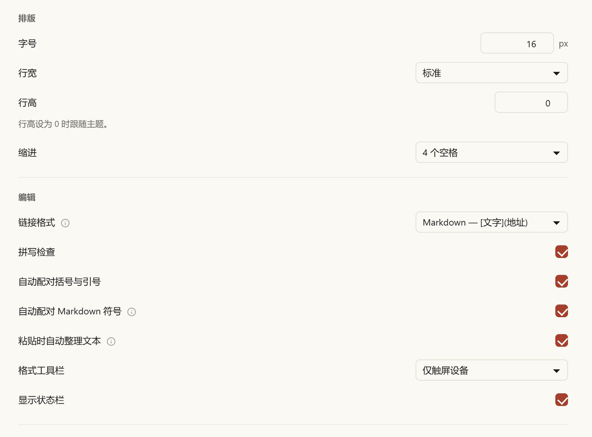

---
aliases:
  - 设置详解
---

# 设置详解

> 设置页按"你会想改什么"排。

**本文目录**

- [通用](#通用)
- [快捷键](#快捷键)
- [编辑器](#编辑器)
- [外观](#外观)
- [图片](#图片)
- [导出](#导出)
- [插件 / 第三方插件](#插件--第三方插件)
- [主题与插件文件夹](#主题与插件文件夹)
- [密钥](#密钥)
- [自定义 CSS](#自定义-css)
- [隐私](#隐私)
- [重置](#重置)

入口：**文件 › 偏好设置**，或状态栏左下角的齿轮。

---

## 通用

管"保存、索引、文件、外部工具"。

| 分组 | 设置项 | 建议 |
|------|--------|------|
| 保存 | 自动保存 | 保持开启 |
| 保存 | 恢复上次打开的文档 | 保持开启；关闭后每次启动是空白页 |
| 保存 | 文件历史条数 / 保留天数 | 重要文档可调高（默认 50 条 / 7 天） |
| 文件 | 外部文件打开规则 | 智能判定（默认）/ 文件优先 / 按工作区 |
| 文件 | 磁盘文件被外部改动时 | 每次询问（默认）/ 总是保留我的 / 总是重新加载 |
| 文件 | 允许 `morz://` 链接写入笔记 | 默认关；开启后外部链接可新建/追加，`open` 不受影响 |
| MCP | 允许外部 AI 客户端访问文件夹 | 默认关；需要接 MCP 工具时再开 |
| 更新 | 自动检查 / 自动下载 | 自动检查默认开；自动下载默认关，关闭时只提示，开启后下载完在标题栏提示重启 |

---

## 快捷键

**能做什么**：所有命令都能重新绑定；搜索框输入中文或命令 id 都能筛。

**操作**：点某条快捷键 → 按下新组合 → 立即生效；`Backspace` 取消绑定；右上角「恢复默认」。

**撞键**：如果组合已被占用，会在这一行下面直接显示占用它的命令，可选「解除并分配」（解绑对方、把组合改派给当前命令）或「取消」。

**常改的几项**：

- 打字机模式（默认无键）
- 阅读模式（默认 `Ctrl+E`）
- 命令面板（默认 `Ctrl+P`）

---

## 编辑器



| 分组 | 设置项 | 说明 |
|------|--------|------|
| 排版 | 字号 / 行宽 / 行高 / 缩进 | 行高 0 = 跟随主题 |
| 编辑 | **链接格式** | Markdown `[文字](地址)` / 双链 `[[页面]]`；新插入的本地图片也跟随（双链写 `![[图片名]]`，不带目录） |
| 编辑 | 拼写检查 | 系统词典；中文界面默认关，英文界面默认开 |
| 编辑 | 自动配对括号与引号 | 输入 `(` 自动补 `)` |
| 编辑 | 自动配对 Markdown 符号 | 选中文字后输入 `*` 自动包起来 |
| 编辑 | 粘贴时自动整理文本 | 去追踪参数、零宽字符、行尾空白 |
| 编辑 | 标题后回车接列表 | 默认关；大纲笔记/每日笔记可开启 |
| 界面 | 底部工具栏样式 | Editing Toolbar 插件 › 底部 tab；可选「胶囊」（与编辑器格式栏一致）或「标准」 |
| 界面 | 显示状态栏 | 关掉更沉浸；也可直接右键状态栏隐藏，视图菜单恢复 |

---

## 外观

| 项 | 说明 |
|----|------|
| 明暗模式 | 跟随系统 / 总是浅色 / 总是深色 |
| 内置主题 | 八套，各有明暗 |
| 主题设置（⚙） | 蓝托帕石：六套配色、字体、行高、纸张、侧栏背景 |
| 主题文件夹 | 加载 Obsidian 的 `.css` 主题；桌面端导入的主题直接保存在这里（默认位置见下） |
| 主题颜色 | 自定义页面背景、正文色、强调色、侧栏背景、选中背景 |

主题的默认目录：`<应用数据目录>/themes`，详见 [主题与插件文件夹](#主题与插件文件夹)。

详见 [外观与阅读](look.md)。

---

## 图片

| 项 | 说明 |
|----|------|
| 插入位置 | 文档旁的 `assets/` / 与文档同名的目录 / 自定义目录 |
| 目录名 | 自定义目录时的文件夹名 |
| 图片说明 | 单独成段的图片是否显示图注 |

---

## 导出

| 项 | 说明 |
|----|------|
| HTML 与 PDF 使用当前主题 | 关掉 = 素色排版 |
| PDF 页面尺寸 | A4 / Letter / Legal / A5 |
| PDF 页边距 | mm |

详见 [导出与备份](export.md)。

---

## 插件 / 第三方插件

| 页面 | 管什么 |
|------|--------|
| **插件** | 内置插件开关（边注、任务、图谱等） |
| **第三方插件** | 从注册表或本地文件夹安装、启停、查看权限；检查更新 |

### 斜杠指令（内置插件）

设置 › 插件 › 斜杠指令。插件默认停用；在插件页打开右上角开关即生效。开启后，在行首或空格/开括号后输入触发字符（默认 `/`，可改成 `@`）会弹出命令下拉，交互和双链补全一致：输入筛选、`↑`/`↓` 选择、`Enter`/`Tab` 执行、`Esc` 关闭。

- **任务行**优先显示截止日期、任务属性、状态切换等任务指令；普通段落显示段落、插入、格式指令。
- **我的指令**：自定义触发词 + 显示名 + 绑定命令；命令来源与 `Ctrl+P` 相同，核心命令和插件命令都能选。列表可拖动排序、上下移、改名、删除。
- 内置指令固定存在，自定义项排在内置项前面；触发词冲突时自定义覆盖内置。
- URL、日期、路径和代码块里不会触发；例如 `2026/11`、`https://`、`notes/2026`。
- 停用「斜杠指令」插件会立即停止弹出菜单，已保存的触发词和自定义项仍保留。

**权限**：安装时列出的权限就是插件能碰到的范围；不需要的插件及时停用。

**插件的界面足迹是受控的**（UI 克制）：

- 插件注册的右栏面板**默认不显示**：右栏空白处右键，在勾选列表里开启；
- 插件的状态栏图标**默认显示**：状态栏右键 ›「插件状态项」可逐个隐藏；
- 插件贡献的右键菜单项全部收进「插件」二级子菜单，主菜单不会随插件数量膨胀。

**性能守护**：插件持续拖慢响应时（单次回调 >400ms 或 10 秒内占用主线程超 600ms），
会先弹一次提醒；反复发生时第三方插件会被**自动停用**并在插件管理器标出
「已自动停用（性能）」，手动重新开启即可恢复。设置 › 通用可关闭性能守护。

**遇到卡顿想反馈**：帮助菜单 ›「Diagnostics: Record 60s」先开始记录 →
复现卡顿 → 结束后点提示里的「导出报告」，把生成的 JSON 发给维护者即可
（只记本机，不上传；报告含当时主题、启用的插件与卡顿分布，便于定位）。

---

## 主题与插件文件夹

主题和插件都是磁盘上的普通文件，默认放在应用的本地数据目录里。**所有工作区共用**，升级或卸载 Morz 一般不会删除（同步盘备份时记得一起带走）。

| 系统 | 主题 | 插件 |
|------|------|------|
| Windows | `%APPDATA%\com.morz.editor\themes` | `%APPDATA%\com.morz.editor\plugins` |
| macOS | `~/Library/Application Support/com.morz.editor/themes` | `~/Library/Application Support/com.morz.editor/plugins` |
| Linux | `~/.local/share/com.morz.editor/themes` | `~/.local/share/com.morz.editor/plugins` |

- **主题**：一个主题一个子目录，至少含 `theme.css`，可带 `manifest.json`。导入主题时 Morz 会自动复制到这里；也可以直接把现成的 Obsidian 主题目录丢进来。
- **插件**：一个插件一个子目录，含 `manifest.json` 和 `main.js`（可选 `styles.css`），启动时自动扫描。
- **改到别处**：设置 › 外观 › 主题文件夹，或 设置 › 第三方插件 → 目录图标。自定义目录同样会监听，新增/更新文件后自动刷新。
- **Web / PWA**：没有稳定的本地目录，主题存在浏览器存储里；插件用安装/链接目录。

---

## 密钥

插件保存的 API key / token 集中列在这里（只列字段，不显示值，也不写入笔记或设置 JSON）。

| 位置 | 存在哪 |
|------|--------|
| 桌面 | 系统钥匙串（Keychain / Credential Manager） |
| Web / 移动 | 应用内密钥区（IndexedDB） |

每行右侧的「清除」只删这一项；插件下次用到时会让你重新填写。

插件设置里标为密码/密钥的字段（例如 图床 的兰台 API Key、AI 助手的 API Key）会自动出现在这里，不会写进设置 JSON；旧版本留在设置里的明文会在启动时迁移过来。本页只负责查看和清除，不提供手动新增——密钥必须归属于某个插件的设置字段，请到对应插件设置里填写。

---

## 自定义 CSS

全局样式覆盖，最后手段。可以改变量（如 `--write-font-size`）、改某个类的样式。

```css
:root {
  --write-max-width: 760px;
}
```

> 改坏了怎么退：清空该页内容即可。想让改动可复用，建议做成主题（设置 › 外观 › 从内置主题创建）。

---

## 隐私

应用锁：PIN / 生物识别、切后台多久自动锁。忘记 PIN 时用一次性恢复码关闭。

**本地诊断日志**：始终只写本机（不采集正文、不上传），只保留"上一会话"一份快照，
用于崩溃后取证；没有累积日志，也没有需要定期清理的文件。需要反馈卡顿时：帮助菜单 ›
「诊断：记录 60 秒」→ 复现 → 导出；桌面端还可在状态栏诊断角标里打开日志文件夹
（crash.log / perf.log），不需要时自行删除即可。

---

## 重置

设置 › 通用最底部有「恢复默认设置」。**不会删除文档**，只重置偏好、快捷键、主题选择等界面配置。

---

**下一步**：[常见问题](faq.md) · [功能指南](features.md)
