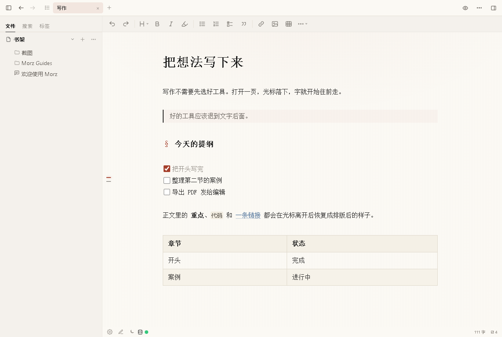
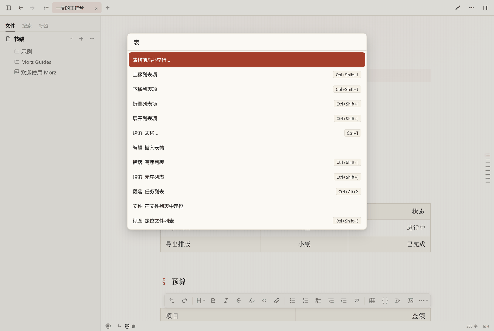

---
aliases:
  - 开始使用
---

# 开始使用

> 装好之后，从打开第一个文件夹到写下第一篇文档。大约 10 分钟。

**本文目录**

- [安装 Morz](#安装-morz)
- [界面导览](#界面导览)
- [第一次打开](#第一次打开)
- [写第一篇文档](#写第一篇文档)
- [四种打开方式怎么选](#四种打开方式怎么选)
- [从 Obsidian / Typora 搬过来](#从-obsidian--typora-搬过来)
- [记住这五个快捷键就够了](#记住这五个快捷键就够了)

---

## 安装 Morz

**Windows**：下载安装包，双击，按提示安装。未签名，SmartScreen 可能提示"未知发布者"，点「更多信息 → 仍要运行」。

**macOS**：下载 `.dmg`，把 Morz 拖进「应用程序」。未公证的版本首次打开需要右键 →「打开」，或在终端执行一次：

```bash
xattr -dr com.apple.quarantine /Applications/Morz.app
```

**Android**：安装 APK。首次安装需要允许"安装未知应用"。

**浏览器 / iPad**：打开网页版，从浏览器菜单选「安装应用 / 添加到主屏幕」，之后可离线使用。

> **提示**：桌面版和手机版可以同时用同一个文件夹（配合你自己的同步盘），Morz 不做同步。

---

## 界面导览



界面分五个区，每一区都能关掉：

| 区域 | 位置 | 干什么 | 怎么开关 |
|------|------|--------|----------|
| **标题栏** | 最上 | 前进/后退、文档标签、右栏开关 | — |
| **左侧栏** | 左 | 文件树 / 搜索 / 标签；顶部切换工作区 | `Ctrl+Shift+L` |
| **正文** | 中 | 所见即所得编辑区 | — |
| **右侧栏** | 右 | 日历 / 大纲 / 反链出链；其他视图在空白处右键勾选 | 视图 › 右侧栏 |
| **状态栏** | 最下 | 视图模式、保存状态、字数；右键可隐藏 | 视图 › 状态栏 |

**两条容易忽略的交互**：

- 正文列两侧的**空白处**也能右键，菜单和正文里一样（返回 / 行宽 / 阅读模式）
- 右栏的标签可以**拖到下半区**，拆成上下两个面板（见 [整理与查找](organize.md#右侧面板上下分区)）

---

## 第一次打开


| 步骤 | 操作 | 会看到什么 |
|------|------|------------|
| 1 | 启动 Morz | 空白引导页 |
| 2 | 点 **打开文件夹…** | 系统文件夹选择框 |
| 3 | 选一个放笔记的文件夹（可以是空的） | 左侧出现文件树，这个文件夹成为"工作区" |
| 4 | 左侧点任意 `.md` | 正文打开，顶部出现标签页 |

**做完应看到**：左栏列出文件夹里的所有 `.md` 和子文件夹；右键文件有重命名、移动、删除。

> **为什么推荐打开文件夹，而不是打开单个文件？**
> 打开文件夹后才有：文件树、全库搜索、标签、反链、大纲跨文件跳转。单文件模式只有一篇文档，像一个没有目录的房间。
>
> **别直接打开「我的文档」根目录或 GitHub 代码库**：里面可能有几十万文件，索引会非常慢。索引超过 15 秒可以手动停止，停止后只加载根目录；下次启动也不会自动全量索引。只跳过 `.` 开头目录、`node_modules`、`__pycache__`、`__MACOSX`，不会误伤 `dist` / `build` / `Pods` 这类正常笔记目录。

---

## 写第一篇文档

| 步骤 | 操作 | 结果 |
|------|------|------|
| 1 | 按 `Ctrl+N`，或点标签栏右侧 `+` | 出现一个未命名的空白文档 |
| 2 | 输入 `# 我的第一篇` | 变成一级标题 |
| 3 | 回车，输入正文 | 普通段落 |
| 4 | 选中一句话按 `Ctrl+B` | 加粗，源码是 `**…**` |
| 5 | 按 `Ctrl+S`，或等自动保存 | 状态栏出现保存标记（正常保存后不显示） |

**关于回车**：按一次是换行（源码多一个 `\n`），连按两次是**新段落**（空一行）。编辑器里看到的每一行，源码里都是真实的一行——这是刻意的设计，避免"点一下跳两行"。

**给文档改名**：点标签栏上的文件名区域即可重命名；或在左侧文件树右键 → 重命名。

---

## 新建、打开与导入怎么选

| 入口 | 什么时候用 | 区别 |
|------|------------|------|
| **新建** `Ctrl+N` | 有想法，还没想好放哪 | 未保存状态，先写后存 |
| **打开…** `Ctrl+Shift+O` | 处理一个散落在别处的 `.md` | 单文件，没有文件树 |
| **导入副本…** | 外部文件要收进当前工作区 | 复制一份到工作区并打开；支持 `.md` / `.txt` / `.html`（HTML 转 Markdown），源文件不动 |
| **打开文件夹…** | 日常写作（推荐） | 工作区：文件树 + 搜索 + 标签 + 反链 |
| **快速打开…** `Ctrl+O` | 已经有工作区，找某篇 | 按标题模糊搜索，回车即开 |

---

## 从 Obsidian / Typora 搬过来

**不用导入**，直接用 Morz 打开你原来的 vault 文件夹。

| 你原来的东西 | 在 Morz 里 |
|--------------|------------|
| `[[双链]]` / `[[页面#^块id]]` / `![[嵌入]]` / `#标签` | 原生支持，点击可跳转；块引用按标题/块 id 定位 |
| `==高亮==`、上下标 | 原生支持 |
| 文件夹结构 | 原样保留，左侧树显示 |
| Obsidian 主题 | 设置 › 外观 › 主题文件夹，指向主题目录；默认在 `<应用数据目录>/themes`（见 [设置详解](settings.md#主题与插件文件夹)） |
| Obsidian 插件 | **不通用**，需用 Morz 插件 SDK 重写 |

**迁移后建议做三件事**：

1. 设置 › 编辑器 › **链接格式** 改成「双链」，这样 `Ctrl+K` 插入的链接和新插入的本地图片都会用 `[[…]]` / `![[…]]`
2. 设置 › 外观 选一个顺眼的主题（蓝托帕石最接近 Obsidian 生态的观感）
3. `Ctrl+P` 搜"快捷键"，把不习惯的改掉

---

## 记住这五个快捷键就够了

| 快捷键 | 作用 |
|--------|------|
| `Ctrl+O` | 快速打开文档 |
| `Ctrl+Shift+F` | 在文件中搜索（全库） |
| `Ctrl+/` | 实时预览 ↔ 源码 |
| `Ctrl+K` | 插入链接 |
| `Ctrl+P` | 命令面板（忘了什么都能在这里搜） |

命令面板长这样，输入中文关键词就能筛。最近在面板里执行过的 5 条命令会排在最前面，并标「最近使用」：



完整快捷键见 [功能指南 › 附录 A](features.md#附录-a--快捷键)。

---

**下一步**：[记录与写作](write.md) · [整理与查找](organize.md) · [外观与阅读](look.md)
